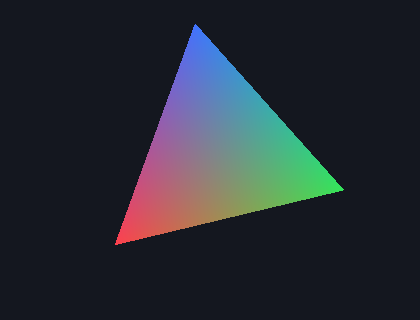
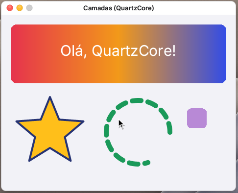

# Metal no mOS (por software)

O mOS não tem driver de GPU. O Metal daqui é um **"GPU" que roda na CPU**: a API do `Metal.framework`
(mais o `CAMetalLayer` do QuartzCore e o `MTKView` do MetalKit) fica no libSystem e executa os
comandos com um rasterizador e um interpretador de shaders próprios. Apps que usam Metal para
desenhar ou calcular rodam sem mudança de código, só que mais devagar que numa GPU.



## Arquivos

| Arquivo | O que faz |
|---|---|
| `userland/libsystem/metal.c` | API: `MTLCreateSystemDefaultDevice`, device, buffers, texturas (memória própria, IOSurface ou buffer; views), samplers, depth/stencil, bibliotecas e funções, pipelines de render e compute, heaps, fences e eventos (`MTLSharedEvent` com listeners), fila, command buffers e os três encoders; todos os descritores (`MTLRenderPassDescriptor`, `MTLRenderPipelineDescriptor`, `MTLVertexDescriptor`... com propriedades genéricas, `copy` e arrays indexados); `MTLCaptureManager` (sem captura); `CAMetalLayer` com drawables; `MTKView` |
| `userland/libsystem/metalexec.c` | Execução: formatos de pixel (8/16/32 bits, half, float, sRGB, BGRA, 10:10:10:2, 11:11:10, 9:9:9:5, 5:6:5, depth16/32, stencil8, depth32+stencil8, BGRA10_XR), amostragem (nearest/linear, mipmaps, endereçamento, borda, cubemap, 3D), rasterizador, compute e blit |
| `userland/libsystem/mtlshader.c` | Compilador de MSL: pré-processador, lexer, parser com tipos, layout de memória do Metal |
| `userland/libsystem/mtlexec.c` | Interpretador da árvore de MSL; fibras para `threadgroup_barrier` |
| `userland/sdk/include/Metal`, `QuartzCore`, `MetalKit` | Headers do SDK do mOS (subconjunto da API da Apple) |
| `userland/tests-metal/main.c`, `tools/build-metaltest.ps1` | Teste de ponta a ponta |
| `userland/samples/Triangulo` | App de exemplo com `MTKView` (shaders em `Resources/Shaders.metal`) |

O `cx_metal_init` é chamado no boot pelo `cx_corevideo_init` (fim do `cx_quartzcore_init`). Um
executável sem metadados de ObjC não passa pelo boot do runtime; por isso `MTLCreateSystemDefaultDevice`
dispara o boot se ainda não houve.

## Como funciona

- **Gravação e execução**: os encoders gravam comandos no command buffer, com uma cópia do estado
  (pipeline, buffers com offset, `setBytes` copiados, texturas, samplers, viewport, scissor,
  culling, depth/stencil) a cada draw ou dispatch em que algo mudou. O `-commit` executa tudo em
  ordem (com um lock global), roda os scheduled handlers, apresenta os drawables e roda os completed
  handlers. Os objetos usados são retidos até o fim da execução. `waitUntilCompleted` volta na hora.
- **Render**: vertex shader por vértice (com `[[stage_in]]` montado do `MTLVertexDescriptor`, em
  todos os formatos de vértice, passo por vértice, por instância ou constante; draws indexados de
  16/32 bits com primitive restart, instâncias, `baseVertex`/`baseInstance` e draws indiretos),
  recorte no espaço de recorte (0 ≤ z ≤ w, w > 0, faixa de proteção em x/y), viewport, scissor,
  culling e winding, triângulos, strips, linhas, line strips e pontos (`[[point_size]]`,
  `[[point_coord]]`), preenchimento em linhas, regra top-left, interpolação com correção de
  perspectiva, `[[flat]]` e `[[center_no_perspective]]`. O stage_in do fragmento é casado com a
  saída do vértice por `[[user(...)]]` ou pelo nome do membro. Profundidade (as 8 comparações,
  escrita, `[[depth(...)]]`, teste antecipado quando o shader não escreve depth nem descarta, depth
  bias, depthClipMode clamp), estêncil (comparações, as 8 operações, máscaras, frente/verso),
  `discard_fragment`, até 8 color attachments com blending (todos os fatores e operações, blend
  color) e máscara de escrita, load action clear e resolve de MSAA (as texturas MSAA são guardadas
  com uma amostra).
- **Compute**: `dispatchThreadgroups`, `dispatchThreads` (grupos não uniformes), indireto,
  `[[threadgroup(n)]]` e `threadgroup` estático. Kernels com `threadgroup_barrier` rodam cada thread
  numa fibra (troca de contexto em assembly); na barreira todas as threads do grupo param antes de
  qualquer uma seguir. Grupos com barreira vão até 256 threads. Simdgroups têm uma thread só
  (`simd_sum` etc. devolvem o próprio valor, o que é consistente com `[[threads_per_simdgroup]]` = 1).
- **Blit**: buffer↔buffer, buffer↔textura, textura↔textura (região, níveis e fatias),
  `fillBuffer`, `generateMipmapsForTexture`.
- **Shaders (MSL)**: struct (float3 com 16 bytes, packed_float3 com 12, alinhamento do Metal),
  enum/enum class, typedef/using, namespace, `#define` objeto e função, `#if/#ifdef/#elif`,
  `#include` dos .metal do bundle; escalares de 8 a 64 bits, half, vetores 2–4 e packed, matrizes NxM,
  `array<T,N>`, ponteiros e referências device/constant/threadgroup/thread, atomics, texture1d/2d/
  2d_array/3d/cube/buffer e depth2d (`sample`, `read`, `write`, `gather`, `sample_compare`, `get_*`,
  `level()`/`bias()`), `sampler` e `constexpr sampler`, funções auxiliares com sobrecarga e recursão,
  todos os comandos de C, swizzles de leitura e escrita, construtores, listas de inicialização,
  `static_cast`/`as_type`, e as funções embutidas comuns (math, geométricas, `select`, `mix`,
  `smoothstep`, bits, pack/unpack, `atomic_*_explicit`). Fora: templates, lambdas, métodos em struct,
  argument buffers, function constants (ficam com o valor padrão), mesh/tile/raytracing, derivadas
  (`dfdx` = 0).
- **CAMetalLayer**: `nextDrawable` devolve uma textura sobre um IOSurface BGRA (pool de até 3,
  sem reaproveitar o que está na tela); `present` põe o IOSurface como `contents` do layer e o
  compositor do QuartzCore desenha na janela. Formatos que não são BGRA8 (RGBA16Float, BGR10A2...)
  são convertidos no present. O `drawableSize` segue bounds × contentsScale se não for fixado.
- **MTKView**: `CAMetalLayer` como backing layer, `currentDrawable`, `currentRenderPassDescriptor`
  (com depth/stencil e MSAA criados sob demanda), `clearColor`/`clearDepth`/`clearStencil`, delegate
  (`drawInMTKView:`, `mtkView:drawableSizeWillChange:`), `paused`, `enableSetNeedsDisplay`,
  `preferredFramesPerSecond` (um `NSTimer`) e `draw`.

## Limites conhecidos

- `.metallib` (AIR) baixa para o interpretador quando a função cabe nos 17 opcodes e nos intrínsecos conhecidos.
  Função que não baixa é omitida; se nenhuma baixa, `newLibraryWithData:` devolve erro. O diferencial de host
  (`tools/airlower_test.c`) compara o bitcode do clang com o shader compilado do fonte. Não há conferência contra
  um `.metallib` de app. O `newDefaultLibrary` continua compilando os `.metal` de `Resources`.
- Desempenho de CPU: o fragment shader é interpretado por pixel. Bom para UI e cenas simples; jogos
  pesados ficam lentos.
- Processos do Chromium/Electron (VS Code, Cursor, Slack...) continuam vendo `MTLCreateSystemDefaultDevice`
  = nil, para manter o caminho de software (SwiftShader) que já funciona; o ANGLE/Metal deles gera
  MSL grande demais para valer a pena aqui. `MOS_METAL=1` força o device; `MOS_METAL=0` desliga para todos.
- Sem captura de GPU, contadores, indirect command buffers, argument encoders, binary archives,
  dynamic libraries, rasterization rate maps nem encoders paralelos (devolvem nil).

## Testes

```
.\tools\build-libsystem.ps1
.\tools\build-metaltest.ps1
.\build\machotest.exe build\libSystem.mos build\metaltest build\metaltest\MetalTest.app\Contents\MacOS\MetalTest
```

O teste confere compute (`dispatchThreads` com grupos de 32, redução com threadgroup memory +
barreira + `atomic_fetch_add`, structs com float3, matriz float3x3, aritmética de `uint` com overflow,
`switch`), render (vertex descriptor, clear, interpolação, cobertura exata de 512 pixels de um
triângulo em 32×32, completed handler), textura escrita num kernel e amostrada com `constexpr
sampler`, teste de profundidade, blit textura→buffer e erro de compilação como `NSError`.

O harness tem `MACHOTEST_DUMP=<arquivo.bmp>`, que grava o último quadro da janela (é de onde saiu a
imagem acima, com o sample `Triangulo`). No Git Bash, rode com `MSYS_NO_PATHCONV=1` e caminhos no
formato `C:/...`, senão o `MACHOTEST_PATH` vira um caminho do Windows.

## Metal ao redor: MetalKit, CoreVideo e MPS

- **`MTKTextureLoader`**: texturas a partir de `CGImage`, `NSData`, URL, nome no bundle (PNG/JPEG/GIF/BMP
  pela decodificação do sistema) e listas de URLs, com as opções sRGB, mipmaps (gerados), uso, modo de
  armazenamento e origem (inverte as linhas), nas versões síncronas e com `completionHandler`.
- **`CVMetalTextureCache`**: `CVMetalTextureCacheCreateTextureFromImage` cria a textura sobre o IOSurface do
  `CVPixelBuffer` (ou sobre a memória dele, se não tiver IOSurface), por plano.
- **MetalPerformanceShaders**: `MPSSupportsMTLDevice`, `MPSImageBilinearScale` e `MPSImageLanczosScale`
  (com `scaleTransform`; na redução o destino é a média da área coberta).

## CoreAnimation (`coreanimation.c`)

O WhatsApp (Catalyst) e o SwiftUI usam a parte de animação e as camadas especiais do QuartzCore. Ficam num
arquivo próprio, em cima do `CALayer` do `quartzcore.c`, inicializado pelo `cx_metal_init`:



- **Animações de verdade**: `-[CALayer addAnimation:forKey:]` (que era no-op) agora copia a animação e um
  animador a 60 Hz calcula o valor a cada quadro e o aplica pelo setter tipado do layer. Vale para
  `CABasicAnimation` (from/to/by, additive), `CASpringAnimation` (massa, rigidez, amortecimento,
  `settlingDuration`), `CAKeyframeAnimation` (values, keyTimes, timingFunctions, discreto/linear, `path`),
  `CAAnimationGroup` e `CATransition` (só tempo e delegate). Duração, `beginTime`, `speed`, `timeOffset`,
  `repeatCount`/`repeatDuration` (inclusive infinito), `autoreverses`, `fillMode` + `removedOnCompletion`,
  `animationDidStart:`/`animationDidStop:finished:`, `removeAnimationForKey:`, `animationForKey:`,
  `animationKeys`. Key paths: opacity, position(.x/.y), anchorPoint, bounds(.origin/.size e componentes),
  frame, transform(.scale/.rotation/.translation e eixos), sublayerTransform, cores (fundo, borda, sombra,
  preenchimento, traço, texto), cornerRadius, borderWidth, zPosition, sombra, lineWidth, strokeStart/End,
  startPoint/endPoint e, de forma discreta, qualquer outra propriedade de objeto. `CAMediaTimingFunction`
  com as curvas padrão e pontos de controle.
- **`CAShapeLayer`**: path com retas, quadráticas e cúbicas, preenchimento nonzero/even-odd, traço com
  largura, pontas (butt/round/square), junções (miter com limite, round, bevel), tracejado com fase e
  `strokeStart`/`strokeEnd`. **`CAGradientLayer`**: axial, radial e cônico, com `locations`.
  **`CATextLayer`**: `NSString`/`NSAttributedString`, fonte, tamanho, cor, alinhamento, quebra de linha e
  reticências. As três desenham com antisserrilhado num IOSurface BGRA pré-multiplicado que vira o
  `contents`; o desenho é refeito no quadro seguinte a qualquer mudança de propriedade, tamanho ou escala,
  e respeita `geometryFlipped` (inclusive herdado).
- **`CADisplayLink`**: `displayLinkWithTarget:selector:` (iOS/Catalyst) e
  `-[NSView/NSWindow/NSScreen displayLinkWithTarget:selector:]` (macOS 14), com timestamp, targetTimestamp,
  duração, pausa e `preferredFramesPerSecond`.
- **`NSValue`** com structs (CGPoint, CGSize, CGRect, CATransform3D, CGAffineTransform, NSRange, insets,
  ponteiros), que o Foundation do mOS não tinha e as animações usam.
- **Só modelo** (as propriedades existem, o desenho é o do `CALayer` comum): `CAReplicatorLayer` (réplicas
  não são geradas), `CATiledLayer`, `CAEmitterLayer`/`CAEmitterCell` (sem partículas), `CAScrollLayer`.
  `CARenderer` existe sem desenhar. Também `CATransform3DMakeRotation`/`Rotate`, `CAFrameRateRange` e as
  constantes `kCA*`.
- O quartzcore.c continua desenhando só escala e translação do `transform`: rotações animadas mudam o valor,
  mas não aparecem rotacionadas.

Medido com `machocheck` no WhatsApp: QuartzCore 61 → **0** símbolos ausentes, MetalKit 1 → 0, CoreVideo
21 → 0, MetalPerformanceShaders 3 → 0 (o Metal em si já estava em 0); no total, de 7.894 para 7.783 símbolos distintos ausentes. O sample `userland/samples/Camadas`
mostra tudo isso (imagem acima, no QEMU).

**Validação no QEMU (7 nov.)**: com o libSystem oficial, o `MetalTest` passa inteiro no mOS de verdade
(14/14 no log serial) e o `Triangulo` gira na janela; o `Camadas` desenha forma, gradiente e texto e anima o
quadrado, com os delegates chamados e o `CADisplayLink` contando quadros.

## GPU do kernel (ABI r1)

`gpucall.c` chama `SYS_GPU` (62, `syscall.h`) com os tipos de `kernel/include/mos_gpu.h`.
`IOSurfaceCreate` BGRA, que é o drawable do `CAMetalLayer`, usa o BO e o id da ABI
quando `MOS_GPU_INFO` traz `MOS_GPU_CAP_IOSURF`. O que falta para o submit 3D está
em `docs/metal-gpu-needs.md`. A janela continua no compositor do QuartzCore.
