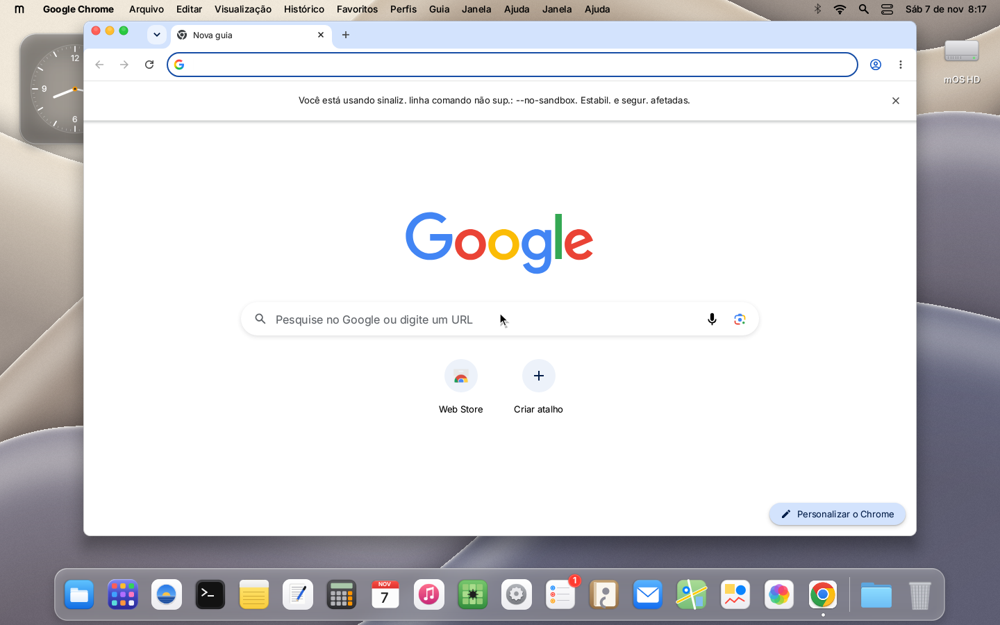
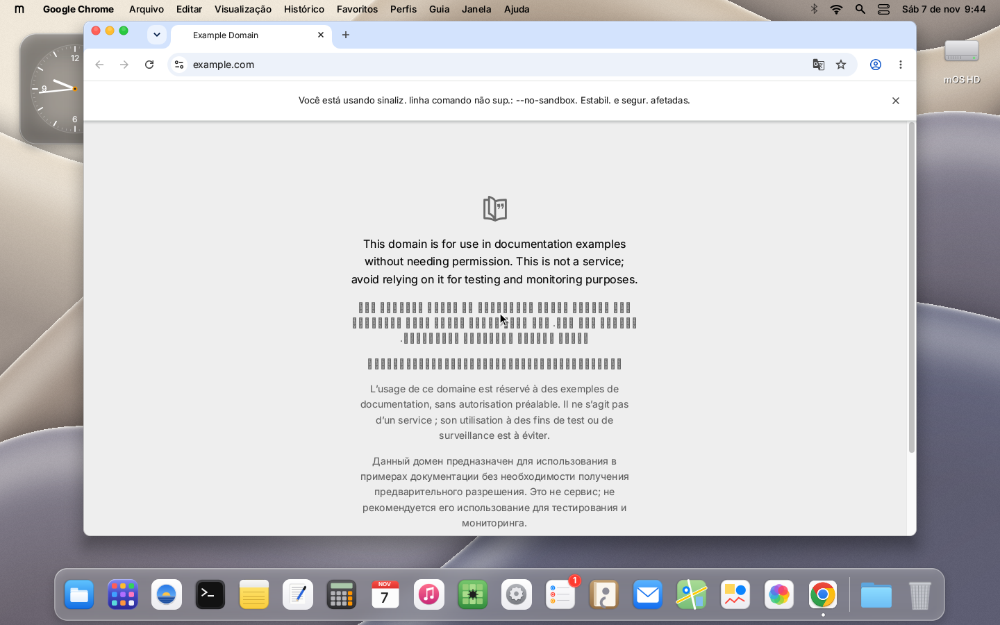
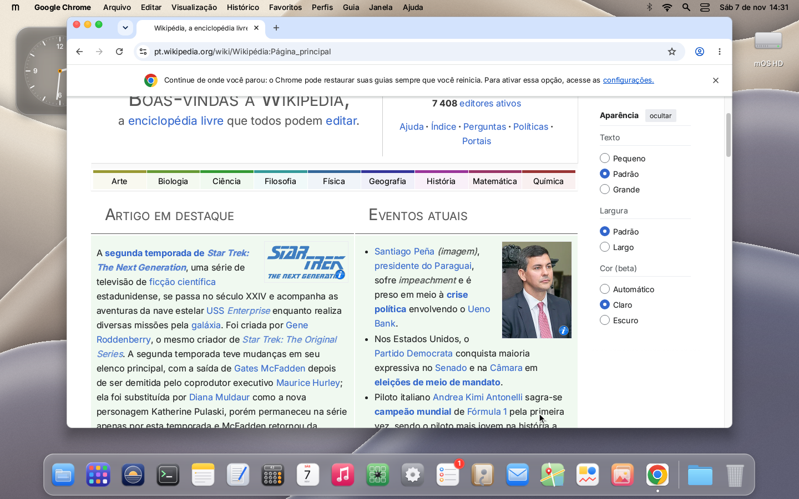
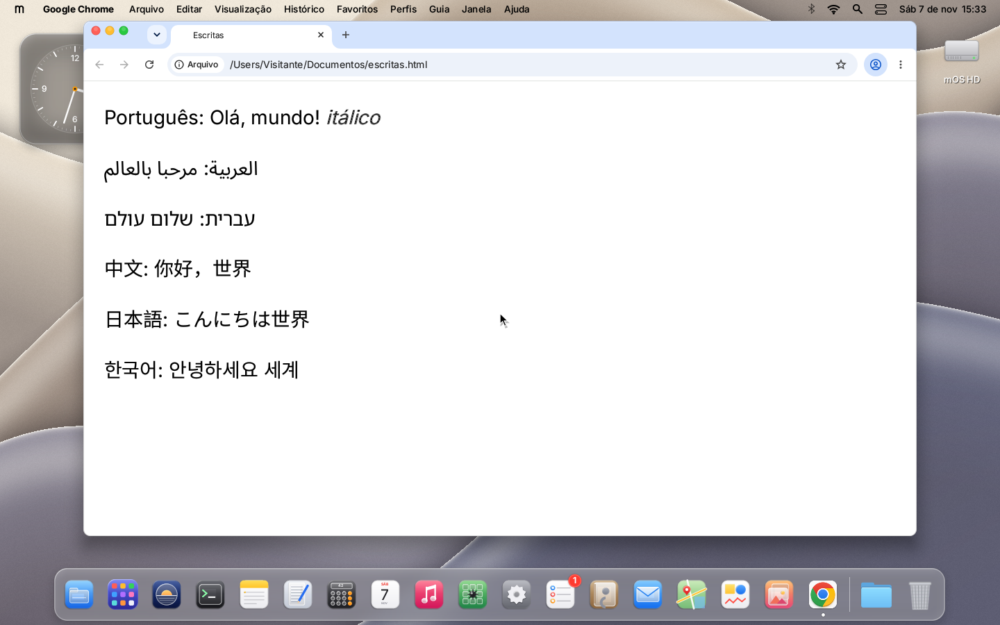

# Porte do Google Chrome para o mOS

Objetivo: rodar o **Google Chrome para macOS (Intel x64)**, sem modificações, como `/Aplicativos/Google Chrome.app`.
Versão medida: Chrome 157.0.8103.39 (`googlechrome.dmg` universal, 270 MiB, de `dl.google.com`).

O Chrome é Chromium puro: o mesmo motor do Electron que o VS Code usa. Quase tudo o que falta para ele é o que
falta para o VS Code (`docs/porte-vscode.md`), então os dois portes andam juntos.

## Onde estamos (6 nov. 2026; estado atual na seção "Sem flags, aberto pelo Launchpad")

| Etapa | Estado |
|---|---|
| Abrir o `.dmg` do Chrome (chunks LZMA/ULMO) | ✅ `kernel/fs/xz.c`, descompressor xz/LZMA2 próprio; o volume HFS+ "Google Chrome" monta com 394 arquivos e 0 erros (723 MiB) |
| Ler o bundle (`Info.plist`, executável universal x86_64+arm64) | ✅ o carregador escolhe a fatia x86_64 |
| Executável `Google Chrome` carrega e roda | ✅ só 1 import ausente (`abort_report_np`) |
| `dlopen` do `Google Chrome Framework` (264 MiB na fatia x86_64) | ❌ **bloqueio atual**: o `dlopen` do libSystem devolve NULL |
| Framework: 2.708 imports, 1.992 ausentes | ❌ |
| Helpers (GPU, Renderer), IPC Mach, janela | ❌ (mesmo roteiro do VS Code, itens 5 a 7) |

### Validação (6 nov. 2026)

- **Descompressor xz contra a liblzma 5.8.3** (arquivos gerados pelo `bsdtar -J` do Windows): 7 de 7 casos idênticos byte a byte,
  com níveis 0, 6 e 9, multibloco (`threads=4`), streams concatenados, dados aleatórios (chunks sem compressão) e 22 MiB
  de binário. Entrada truncada ou corrompida devolve erro sem travar (testado com UBSan).
- **Arquivos extraídos contra a assinatura de código do Google**: as 159.836 páginas das 20 imagens Mach-O
  (fatias x86_64 e arm64) batem com os hashes SHA-256 do CodeDirectory.
- **Dentro do mOS (QEMU, 2 GiB)**: no boot, `dfs: montado "Google Chrome" (HFS+, ULMO)`; o volume aparece em Locais no
  Arquivos, com botão de ejetar, e mostra o `Google Chrome.app`. O DMG (269 MiB) passa do limite de 256 MiB de
  `persist.c` para arquivos carregados no boot; o teste usou um kernel com `-DMAX_LOAD=(512ull<<20)`.

### Dentro do mOS (6 nov. 2026, 17h30)

- `tools/stage-chrome.ps1` monta o Chrome em `/Aplicativos/Google Chrome.app` numa imagem de teste: só a fatia x86_64
  (309,5 MiB no total, com o framework de 264 MiB), recursos do Chromium e as traduções en/pt_BR.
- O Chrome aparece no Launchpad e na Busca com o ícone dele. Ao clicar, o processo sobe, para no `dlopen` e o mOS mostra
  "\"Google Chrome\" fechou inesperadamente. O app encerrou com o código 134 (abort)" (antes ele sumia sem aviso).
- Funções que só o Chrome pede (269, das 1.893 ausentes; as outras 1.624 o VS Code também pede e as sessões dele cobrem):
  `userland/libsystem/chrome.c` resolve a maior parte. CoreVideo e os `CF*GetTypeID` ficaram com as sessões donas
  (corevideo.c, cfcollections.c). Com tudo junto, o framework caiu de 1.992 para 1.504 imports ausentes. Quando o recurso não existe no mOS (Keychain, DiskArbitration, MIDI,
  Bonjour, assinatura de código...), a função devolve o erro documentado de "indisponível", nunca 0 (= sucesso).
  Sobram 21 classes ObjC (o carregador as liga a `NSObject`), 3 constantes que podem ser nulas e 3 que são de outras
  sessões: `CFDictionaryApplyFunction` (cfcollections.c), `IOSurfaceGetBytesPerElementOfPlane` e `dispatch_data_create`.

### Com o dlopen (7 nov. 2026, madrugada)

Dentro do mOS (QEMU, 3 GiB), aberto pelo Launchpad:

| Etapa | Estado |
|---|---|
| `dlopen` do framework (264 MiB) | ✅ 13 símbolos ausentes (de 1.992 no começo) |
| ICU (`icudtl.dat`) | ✅ depois de `NSBundle` achar `Resources/` numa pasta `Versions/<v>` (foundation.c) |
| Crashpad | ✅ `fork` + `chrome_crashpad_handler` sobem; `shutdown` em socketpair não dá mais EBADF (sockets.c) |
| Singleton do perfil | ✅ `stat` devolve o modo pedido em `mkdir`/`chmod` (0700 do `mkdtemp`; libc.c) |
| `base/mac/mac_util.mm` | ✅ sysctls que faltavam (darwin.c) |
| Swizzle do menu Serviços | ✅ não era exceção: o `int3` em `0x4483d77` era o `CHECK` do bloco de `+[ChromeSwizzleServicesMenuUpdater install]`, que exige as classes privadas `_NSServiceEntry` (`-bundleIdentifier`) e `_NSServicesMenuUpdater` (`-populateMenu:withServiceEntries:forDisplay:`, `-plugMenu:intoMenu:`); criadas em `chrome.c` (`cx_chrome_init`, chamado por `cx_objc_boot`) |
| Menu principal | ✅ o Chrome monta o `NSMenu` (avisos de `NSMenuItem setAlternate:/setHidden:/setImage:`, `NSMenu itemWithTag:`, `sectionHeaderWithTitle:` ainda não implementados, sem cair) |
| **Agora** | ⏳ o processo fica vivo (minutos) sem janela e sem iniciar nenhum `Google Chrome Helper` (GPU/Renderer): falta descobrir em que ele espera |

### Helpers sobem (7 nov. 2026, manhã)

| Bloqueio | Causa no mOS | Correção |
|---|---|---|
| Thread principal girando sem parar | `dispatch_async` na fila principal antes do CFRunLoop executava na hora; o `-rebuildMenu` do Chrome se reagenda | dispatch.c: de dentro de um bloco já executado assim, vai para a fila |
| Laço infinito no menu | NSMenu sem `itemAtIndex:`/`removeItemAtIndex:`/`numberOfItems`, NSMenuItem sem `isSeparatorItem` | appkit.c: NSMenu/NSMenuItem completos (índice, tag, título, separador, oculto, alternativo, imagem, cabeçalho de seção) |
| Helper não carregava `libaperitif.dylib` | `process_t.path` tinha 128 bytes; o caminho do helper tem 198 e `@executable_path` saía cortado | proc.h (e tools/host_proc.h): 384; macho.c: `executable_path=` com 420 |
| Helper: `CHECK(bundle)` do framework | `mainBundle` cortava no PRIMEIRO `.app/` (o Chrome de fora); o helper lia o Info.plist errado e não se via como processo de fundo (`LSUIElement`) | foundation.c `b_root`: o `.app` que contém `Contents/MacOS/<exe>` |
| Helper: `thread_local` lia lixo | slot 101 da TSD usado por dois donos: tabela de TLS (darwin.c) e objeto NSThread (nsurl.c) | darwin.c: TLS no slot 110; lista dos slots fixos documentada |
| `dispatch_retain` não fazia nada e `dispatch_release` liberava na hora | — | dispatch.c/extra.c: contagem de referências; objetos estáticos nunca liberados |

**Agora:** o processo principal sobe, inicia o Crashpad e dois `Google Chrome Helper (Aperitif)`, que ficam vivos. O
principal cai na detecção de corrupção do PartitionAlloc (código `0x13`, `0x9cc34a0`, chamada de `0x83b51` logo depois
de `os_unfair_lock_unlock` da raiz): a "lista livre" tem `0x6D4F5351756588` = `QMAGIC` das filas do dispatch.c + 0x13.
Já descartado: liberar fila cedo (com `dispatch_release` sem free nenhum a queda continua), `free`/`in_heap` (brk e mmap
não se sobrepõem) e o COW do `fork` (todas as páginas marcadas). Próximo passo: achar quem escreve uma `cx_queue_t`
num bloco do PartitionAlloc (tracepoint no `dispatch_queue_create` com `@rax` na volta, comparado com o endereço do
bloco corrompido, que sai de `r14`/`r12` em `0x83b28`).

Atualização (com o libSystem de 7 nov., WHPX): com `despejar-threads`, o dispatch.c registra o endereço de cada fila
(`dispatch[diag]`). As filas ficam no heap brk do mOS (`0x40000142ccf0`, `0x40000143ce30`...), fora do PartitionAlloc;
então não é o malloc do mOS entregando memória do Chrome, e sim o PartitionAlloc tratando uma fila do mOS como bloco livre.
Desde que as filas ganharam `isa` (`OS_dispatch_queue_*`), o ARC do Chrome as libera com `objc_release`; a próxima pista
é o caminho `-release` → `dealloc` → `object_dispose` → `cx_object_free` nesses objetos sem cabeçalho de objeto do
mOS (as pilhas das threads que giravam já mostravam `cx_object_free`/`object_dispose`). A queda continua em `0x9cc3297`.

Rodada seguinte (WHPX): o release ObjC das filas foi descartado (objc_release só age com `OBJ_MAGIC` ou classe CRR).
O mzone.c agora reconhece o dono de verdade (`malloc_zone_from_ptr`, `z_claimed`, `malloc_zone_claimed_address`), sem
regressão no harness nem no VS Code (o renderer dele deixou de cair). A queda do Chrome não mudou, mas o tracepoint no
detector (`+0x9cc34a0`) fechou o que o PartitionAlloc acha na lista livre: `OBJC_CLASS_$_OS_dispatch_queue_main+0x10`,
um objeto "fila principal" do mOS (classes `OS_dispatch_*`, da sessão do runtime Swift/ObjC, swiftobjc.c) dentro de um
bloco que o PA considera livre. Próximo passo, com essa sessão: de onde vêm instâncias com esse isa, se passam pela zona
padrão (trocada pelo PA) e se algum release/dealloc delas chama `free` em objeto estático.

**Correção do diagnóstico (7 nov.):** não é corrupção de lista livre. Em `+0x83968` o valor é comparado com
`0x3FFE00000` (limite de alocação do PartitionAlloc) e vai para a rotina de falta de memória (`+0x839c4`/`+0x9cc34a0`):
é o **tamanho** de uma alocação. Ele é sempre o primeiro word de um objeto fila principal do mOS mais 0x10 (o PA soma 16 e
alinha a 8): `QMAGIC+0x13` com o layout antigo, `OS_dispatch_queue_main+0x10` com o `isa`. Alguma API entrega ao Chrome a
fila principal (ou objeto de dispatch com o mesmo começo) onde ele espera outra estrutura e lê o 1º campo como tamanho;
a chamada vem de uma thread que não é a principal. Para achar a cadeia, falta um tracepoint condicional (os atuais disparam
na 1ª passagem, que é uma alocação comum): ex. só quando `rdi > 0x3FFE00000`, em kernel/proc/tracepoint.c.

### Primeira janela (7 nov. 2026, manhã)

Com `0x83b51@pilha` (modo novo do tracepoint: a cadeia de rbp inteira) a alocação absurda saiu de
`sandbox_create_params`/`sandbox_compile_string` (sandbox::Seatbelt): o Chromium lê o perfil compilado como
`struct sandbox_profile {builtin, data, size}` e copia `size` bytes; o mOS devolvia uma struct de 8 bytes e o "size" era a
memória estática vizinha (a classe `OS_dispatch_queue_main`). darwin.c agora devolve a struct real com um bytecode marcador.

Depois disso o Chrome abre **a primeira janela**: barra de menus completa em português (Arquivo, Editar, Visualização,
Histórico, Favoritos, Perfis, Guia, Janela, Ajuda), a janela "Que bom te ver no Google Chrome!" e um alerta "Ocorreu um erro
ao abrir seu perfil...". Os textos vinham só com a 1ª letra: `CFStringCreateWithBytes` só tratava `0x0100` como UTF-16 e o
Chrome usa UTF-16LE (`0x14000100`); agora UTF-16 (BOM/LE/BE, pares substitutos), UTF-32 e Latin-1 viram UTF-8 completo.

Próximos: o erro de perfil (arquivos do perfil em `~/Library/Application Support/Google/Chrome`), o conteúdo da janela
(renderização pelos helpers: o processo de GPU sai com "errors during initialization", sem GPU) e "Janela/Ajuda"
duplicados na barra (o mOS acrescenta os dele).

**Perfil (7 nov., 6h):** o alerta "Ocorreu um erro ao abrir seu perfil" vinha do SQLite ("Unable to commit a
transaction" no `login_database`): o `ftruncate` do libSystem dava ENOTSUP sempre que o tamanho mudava (o journal é truncado
a cada commit) e o `fcntl(F_GETLK)` não preenchia a `struct flock`. Agora há `SYS_FTRUNCATE` (53) no kernel e F_GETLK
responde `F_UNLCK`. Sem o alerta, a janela "Que bom te ver no Google Chrome!" fica ativa — com o conteúdo em branco.
Testado com `-Argumentos '--disable-gpu --in-process-gpu --no-sandbox'` (o processo de GPU deixa de encerrar).
Próximo: a renderização (só dois helpers sobem; ver se o renderer da página de boas-vindas nasce e se o quadro do
compositor chega à NSWindow, como no Electron do VS Code) e o TLS do serviço de rede ("handshake failed", net_error -21).

### Renderers nascem (7 nov. 2026, 7h)

Por que só dois helpers subiam, em ordem:

1. **A janela "Que bom te ver" é o diálogo nativo de primeira execução** (Cocoa, modal). Nenhum `WebContentsImpl::Init`
   rodava (tracepoints nos nomes de TRACE_EVENT: `WebContentsImpl::Init`, `NavigationControllerImpl::LoadURLWithParams`,
   `RenderProcessHostImpl::Init`...): o navegador espera o diálogo fechar, e o AppKit do mOS não desenha os controles dele.
   Por enquanto: `--no-first-run --no-default-browser-check`. (Pendente: desenhar o diálogo.)
2. **`MACaptionAppearanceCopyForegroundColor` devolvia NULL** e o `CaptionStyle` do Chrome exige uma cor sRGB com 4
   componentes (CHECK em `Framework+0x27b0ebb`). chrome.c devolve branco/preto como o padrão do sistema.
3. **Os executáveis dos helpers "Aperitif" (Renderer, GPU, Alerts) não existiam na imagem**: o caminho
   `.../Helpers/Google Chrome Helper (Aperitif Renderer).app/Contents/MacOS/...` tem 272 caracteres e o `dmgtest` e o
   `mkimg` usavam `fopen`/`opendir` ANSI (limite de 260), sem erro. Os dois agora usam `\\?\` + funções wide no Windows
   (o `dmgtest` também acusa "NÃO GRAVADO"), e o `stage-chrome.ps1` também (o alias `lp` do PowerShell é Out-Printer:
   a função chama `Get-LongPath`).
4. Com os helpers: o navegador caía em `-[NSView removeFromSuperview]` lendo o estado de um pai já liberado. NSView ganhou
   `dealloc` que solta as subviews (superview = nil), como no Cocoa.
5. `csops(CS_OPS_TEAMID / CS_OPS_VALIDATION_CATEGORY)` dava ENOSYS e o `ProcessRequirement` do rendezvous Mach falhava
   ("HasSameTeamIdentifier failed"; "about:blank page took too long to load"). darwin.c responde como binário sem
   assinatura: sem Team ID (ENOENT) e categoria NONE (10).
6. `mach_msg` devolvia -4 (espera interrompida por sinal, ex.: SIGCHLD) e o `WaitableEvent` do Chromium tem
   `CHECK(kr == MACH_RCV_TIMED_OUT)`. mach.c retoma a recepção com o prazo restante (ou devolve `MACH_RCV_INTERRUPTED`
   a quem pediu `MACH_RCV_INTERRUPT`), como o XNU.

Resultado: a janela principal do navegador abre (1200x760, sem o diálogo), ~13 processos `--type=renderer` sobem e ficam
vivos, e o navegador não cai mais. Teste: `-Argumentos '--no-sandbox --in-process-gpu --disable-gpu
--enable-logging=stderr --no-first-run --no-default-browser-check'`.

Pendentes:
- **Conteúdo da janela em branco**: o quadro do compositor não chega ao NSWindow (nenhuma IOSurface no log). Próximo
  passo: o caminho `SoftwareOutputDeviceMac` → IOSurface → `DisplayCALayerTree`/`CALayerHost` (notas do porte do VS Code).
- O utility `mac_notifications.mojom.MacNotificationProvider` cai num CHECK (`Framework+0x344f26f`); o navegador o recria.
- Renderer caiu uma vez em `cx_lookup` dentro de `descriptor_for` (coretext.c, `fontName` de uma fonte já liberada?);
  não repetiu nas rodadas seguintes.
- `DumpWithoutCrashing` frequentes vêm de `base/metrics/histogram.cc` (inofensivos por ora).
- TLS do serviço de rede ("handshake failed", net_error -21) e "Janela/Ajuda" duplicados na barra.
- O nome do processo é cortado em 31 caracteres ("Google Chrome Helper (Aperitif ").

### A janela desenha: Nova Guia na tela (7 nov. 2026, 8h)



O caminho do quadro foi seguido por tracepoints nos nomes de TRACE_EVENT (`ExternalBeginFrameSourceMac::OnDisplayLinkCallback`,
`DisplayScheduler::*`, `Scheduler::BeginImplFrame`, `TileManager::*`, `CompositorFrameSinkSupport::MaybeSubmitCompositorFrame`,
`Display::DrawAndSwap`, `SoftwareRenderer::SwapBuffers`, `DisplayCALayerTree::GotIOSurfaceFrame`) e nos desvios de
`LayerTreeHostImpl::CanDraw` (cada motivo de recusa tem sua string). O que faltava, em ordem:

1. **Abort "coleção alterada durante a enumeração"**: `-[NSMenu itemArray]` devolvia o array interno; o Chrome percorre e
   remove itens. Agora é uma cópia, como no Cocoa. NSMenu ganhou `delegate`, NSMenuItem `menu`, e NSWindow `alphaValue`,
   `parentWindow`, `addChildWindow:ordered:`.
2. **Main frame adiado para sempre** (`Scheduler::SetDeferBeginMainFrame(true)` sem o `false`, `CanDraw` "no root
   layer"): o `RecyclableCompositorMac` fica suspenso até a janela ser notada visível, e o Chrome nota isso na sobrescrita
   de `-[NSWindow orderWindow:relativeTo:]` (`NativeWidgetMacNSWindow`). O mOS atendia `orderFront:`/
   `makeKeyAndOrderFront:` direto; agora eles passam por `orderWindow:relativeTo:` por mensagem, que avisa
   `windowDidChangeOcclusionState:`. Com isso a interface do navegador (abas, barra de endereço) aparece.
3. **Renderer com "empty viewport"**: `setFrame:` não chamava `setFrameSize:`/`setFrameOrigin:` por mensagem, e o
   autoresize mudava o quadro das subviews por dentro. A `RenderWidgetHostViewCocoa` sobrescreve `setFrameSize:` para
   avisar o renderer do tamanho. Agora segue o Cocoa: `setFrame:` → `setFrameOrigin:` + `setFrameSize:` →
   `resizeSubviewsWithOldSize:` → `setFrame:` de cada subview, tudo por `objc_msgSend`.
4. **Queda em `descriptor_for` (coretext.c)**: a pilha de autorelease pools era global, e o `pop` de uma thread liberava
   objetos de outra. A sessão do VS Code passou os pools para um por thread (`objc.c`, slot TSD 104) ao mesmo tempo.

Resultado: a **Nova Guia renderiza inteira** (logo, pesquisa, atalhos, "Personalizar o Chrome") e o navegador fica estável.
Teste: `-Argumentos '--no-sandbox --in-process-gpu --disable-gpu --no-first-run --no-default-browser-check'`.

**Rede: ERR_NETWORK_CHANGED.** Abrir `http://example.com/` ou `https://example.com/` mostra "A conexão foi interrompida /
Foi detectada uma alteração na rede" (ERR_NETWORK_CHANGED, -21), com ou sem TLS. O "handshake failed ... net_error -21"
do log é o mesmo erro. Já descartado: não há notificação de IP nem de conexão (`NetworkChangeNotifier::*`), nem flush dos
pools ("IP address changed", "SSL configuration changed", "Cert verifier changed"); o -21 não está na tabela errno → erro
do Chromium (`MapSystemError`) nem nas constantes `mov $-21` rastreadas. Houve uma `NetworkChangeNotifier::DnsChange` no
serviço de rede ("DNS config watch failed to start"). Próximo suspeito: o resolvedor de DNS do Chrome (cliente DNS próprio
por UDP, que o mOS ainda não tem, e o `HostResolverManager` abortando jobs com ERR_NETWORK_CHANGED na mudança de DNS).

### Navega, digita, abas e HTTPS (7 nov. 2026, 9h45)



- **Rede**: a causa do ERR_NETWORK_CHANGED foi achada pela sessão do VS Code. O Chromium 15x, para contornar um bug do
  XNU, confere o RDX depois de `sendto()`, e o `sendto` do libSystem deixava lixo ali (`sockets_inet.inc` agora devolve
  RAX = resultado e RDX = 0). Depois disso o navegador caía em
  `CHECK((fcntl(fd, F_GETFL) & O_ACCMODE) == O_RDONLY)`: o F_GETFL devolvia sempre O_RDWR. libc.c guarda o modo de acesso
  de cada fd (`open`, `pipe`, `dup`/`dup2`). Com isso **`https://example.com/` carrega** (TLS do BoringSSL do Chrome).
- **Página local** (`file:///Users/Visitante/Documentos/chrome-teste.html`): acentos, negrito, sublinhado, link,
  flexbox, gradiente, sombra, SVG, `<canvas>`, tabela, campo de texto e JS rodam ([captura](img-chrome-pagina-local.png)).
- **Entrada**: digitação no campo (o evento `input` do JS dispara), ⌘A/⌘C, ⌘L (foca a barra de endereço), ⌘V (cola),
  ⌘T (Nova Guia renderizada) e ⌘W (fecha só a aba; a outra volta desenhada).
  - Kernel (`kernel/ui/desktop.c`): o ⌘W segue o atalho do menu do app antes do "fechar janela" do sistema, e em app do
    macOS o ⌘L é do app (o Launchpad continua no F4).
  - AppKit: `viewWillMoveToWindow:`/`viewDidMoveToWindow` vão para a subárvore inteira, e `setHidden:` manda
    `viewDidHide`/`viewDidUnhide` (a `WebContentsViewCocoa` recalcula a visibilidade da página aí; antes a aba que voltava
    ficava em branco).
- **Menus**: "Janela" e "Ajuda" do sistema só entram na barra quando o app não traz os dele (antes, duplicados).
- **Processos**: o utilitário `mac_notifications` fazia `CHECK(NSApp)` e o navegador o recriava sem parar. Agora o
  `NSApp` é publicado nesse utilitário, e continua nulo nos outros helpers (o renderer exige `NSApp == nil`). Abrir e
  fechar abas não deixa renderers: o navegador encerra o da aba fechada com SIGTERM.

Pendentes: *itálico* sai reto (falta face itálica ou oblíqua sintética); árabe/hebraico/CJK sem fonte de fallback
(caixinhas); a janela de primeira execução (`--no-first-run` por enquanto); fechar a janela pelo botão vermelho derruba
o navegador no desmonte (`windowWillClose:`); o aviso do `--no-sandbox`.

Ferramentas: `tools\stage-chrome.ps1 -AutoAbrir` (o `init` abre o Chrome no boot, sem depender do mouse no QEMU) e
os tracepoints (`/Sistema/Biblioteca/diag-tracepoints`), que agora também valem para imagens do `dlopen` (macho.c).

Para achar a causa de cada queda: `llvm-objdump -d --start-address=... ` (LLVM em `C:\Program Files\LLVM\bin`) no
framework de `build-chrome\esp\...`; o endereço do log menos `0x400100000000` é o endereço no arquivo.

### Sem flags, aberto pelo Launchpad (7 nov. 2026, tarde)



O Chrome agora abre como uma instalação normal: **sem nenhuma flag** (sem `--no-sandbox`, `--in-process-gpu`,
`--disable-gpu`, `--no-first-run`) e **sem o modo experimental** (`/Sistema/Biblioteca/dyld-experimental`). Testado no
QEMU: Launchpad → busca "chrome" → Enter → diálogo de primeira execução pelo mouse (desmarcar "navegador padrão", OK) →
"Continuar sem fazer login" → Nova Guia → ⌘L, `pt.wikipedia.org`, Enter → a página carrega inteira e rola.

| Problema | Causa | Correção |
|---|---|---|
| Sub-recursos HTTPS falham (despezzas.com sem CSS/imagens) | O `recv` ignorava `MSG_PEEK`. O Chromium espia 1 byte (`SocketPosix::IsConnectedAndIdle`) ao reaproveitar socket do pool; o mOS consumia o byte e o fluxo TLS desalinhava: alertas record_overflow/bad_record_mac/protocol_version, e depois `PROTOCOL_IS_SHUTDOWN` (error_reason 194) em toda escrita | sockets.c/sockets_inet.inc: buffer de bytes espiados por socket; `MSG_WAITALL` e `MSG_DONTWAIT` também |
| Renderer caía com CSS de cor (`oklab(...)`), página branca | **`exp2` do libSystem errado para todo app**: `fsub %st, %st(1)` em AT&T dá n − x, a fração saía com o sinal trocado (`exp2(-0.5)` = 1,414). `exp`/`pow`/`powf` herdavam; o skcms (`sign*powf(a*x+b,g)+e`) dava não finito e caía no CHECK `Framework+0xb1a843a` | libc.c: n = rint(x), f = x − n, `f2xm1` + `fscale`; NaN/±inf tratados. Conferido no host contra a libm (erro ≤ 1e-7 em float) |
| Navegador caía ao fechar a janela (botão vermelho ou ⌘W na última aba) | `windowNumber` devolvia o gid do window server, 0 para janelas que nunca foram à tela. As três `NativeWidgetMacOverlayNSWindow` ficavam com 0 no mapa global do Chrome indexado por `windowNumber`, e o destrutor apagava `end()` (`Framework+0x2f5b793`) | appkit.c: número único e fixo por janela. Também: o botão vermelho, o ⌘W do sistema e o Dock viram **pedido** (`on_close_request` no wm.c/guisys.c → `performClose:` → `windowShouldClose:` → `-close` por mensagem), como no Cocoa; `CVDisplayLinkStop`/`Release` esperam o callback em andamento (corevideo.c) |
| Queda na partida em `network_config_watcher_apple.cc` | sysconfig.c novo usava `static __thread`; o libSystem é freestanding e o `%fs` das threads é 0 | variável comum |
| CHECK `(fcntl(fd, F_GETFL) & O_ACCMODE) == O_RDONLY` depois de "Continuar sem fazer login" | fd que não veio do `open()` deste processo (fileport) → F_GETFL dizia O_RDWR | kernel: `SYS_FDFLAGS` com b = 2 devolve o modo da abertura; libc.c pergunta ao kernel quando não sabe |
| Itálico reto | o Skia põe a inclinação do itálico sintético na matriz de texto (c = 0,25) e o `cx_bitmap_draw_glyph` a ignorava | coregraphics.c: cisalhamento por linha do glifo, com a cobertura dividida entre dois pixels |
| Diálogo de primeira execução sem controles | (resolvido pelas correções de visibilidade/oclusão das outras sessões: `NSThemeFrame`, `occlusionState`) | caixa de seleção, link, OK e a tela "Faça login no Chrome" (WebUI) funcionam pelo mouse |
| Sem `dyld-experimental` o Chrome não abria | 41 bibliotecas do sistema "ausentes" (Carbon, CoreImage, libsandbox, SkyLight...) | macho.c: os frameworks que o Chrome pede entram na lista do `libsystem_dylib_ok`; o que faltar vira stub que encerra dizendo o nome. O `stage-chrome.ps1` não grava mais o arquivo |

Também: ⌘V na barra de endereço confirmado (⌘L ⌘C numa aba, ⌘T, ⌘L ⌘V: a URL aparece; a falha anterior era só espera
curta); o relatório de falha do kernel imprime a cadeia de rbp (`proc:   chamadas: ...`), que deu as pilhas acima.

Ainda falta:
- **Processo de GPU**: sem flags ele sobe e sai cinco vezes ("Exiting GPU process due to errors during initialization":
  ANGLE/Metal e o SwiftShader falham em `GLDisplayEGL::Initialize`, sem nenhum `dlopen` do `libvulkan.dylib`); depois o
  Chrome compõe por software no navegador e tudo aparece. Custa ~10 s na partida e deixa sem WebGL. Próximo passo: por que
  o ANGLE não tenta o Vulkan/SwiftShader (o mesmo caminho do `--use-angle=swiftshader`).
- Queda intermitente: um fd que o Chrome passa por Mojo já não existe no kernel (`fileport_makeport` EBADF em
  `wrapped_platform_handle.cc:105` e CHECK no `close` de `scoped_file.cc:45`). Viu-se duas vezes, uma no navegador e uma
  num helper. Suspeita: alguém fecha um fd do Chrome (libSystem abrindo/fechando arquivos internos em outra thread?).
- `OnDeviceModelService` (IA local, pede GPU) cai num CHECK (`Framework+0x2548f49`); o Chrome segue.
- Depois de fechar a última janela o processo continua vivo (como no macOS), mas o mOS tira o Chrome do Dock e da barra
  de menus (app sem janela perde o foco); falta o "reabrir" pelo Dock.
- ~~Árabe/hebraico/CJK em caixinhas~~: resolvido, ver abaixo.
- O clique no banner de cookies do despezzas.com não fez efeito numa rodada (os cliques do diálogo, da WebUI e do
  Launchpad funcionaram); repetir com espera maior.
- Instalar pelo Horizonte (baixar o `.dmg`, montar, arrastar para Aplicativos) de ponta a ponta ainda não foi testado
  nesta sessão; o carregamento e a abertura já não dependem de nada que o `stage-chrome.ps1` faça além de copiar o app.

### Árabe, hebraico e CJK (7 nov. 2026, 15h30)



- **Fontes**: Noto Sans Arabic, Hebrew, SC, JP e KR (SIL OFL 1.1, licença em `Noto-OFL.txt`) em
  `root/mOS/Sistema/Biblioteca/Fontes`, que o `build.ps1` copia para a imagem. As CJK são os subconjuntos OpenType/CFF do
  repositório noto-cjk (até 7,9 MiB, abaixo do limite de 8 MiB do GF_REGISTER).
- **Fallback** (coretext.c): `CTFontCreateForString(WithLanguage)` confere no cmap se a fonte pedida tem o primeiro
  caractere do trecho. Se não tem, registra sob demanda a primeira Noto que tem o glifo; o mesmo arquivo dá o mesmo id em
  todo processo. Para Han a ordem segue o idioma: ja → JP, ko → KR, o resto → SC; kana vai para JP e hangul para KR.
- **Kernel** (font_cff.inc): `CFF_MAX_FD` subiu de 16 para 64. As Noto CJK com CID têm 18 FDs e eram recusadas
  (conferido no host com `tools/cfftest.c`).
- **Pontos do árabe**: a Noto separa os pontos em marcas (`ccmp`) e as posiciona pelo GPOS. O Skia pergunta
  `CTFontCreatePathForGlyph(f, g, NULL)` a todo glifo de avanço zero e descarta o glifo se o caminho vier vazio; o mOS
  devolvia NULL, e todos os pontos e diacríticos sumiam. Agora, sem matriz, a função devolve a caixa do glifo.
- Conferido no QEMU com uma página local nas cinco escritas (ligação, direita-para-esquerda e pontos certos).

Como o Chrome inicia: o executável `Contents/MacOS/Google Chrome` (0,3 MiB) só monta o caminho
`../Frameworks/Google Chrome Framework.framework/Versions/<versão>/Google Chrome Framework`, chama `dlopen`,
procura `ChromeMain` com `dlsym` e pula para lá. Sem `dlopen` em tempo de execução ele para nesse ponto:

```
dlopen .../Google Chrome Framework: dlopen não é suportado no mOS.
Abort trap: 6
```

## Próximo passo: `dlopen` em tempo de execução

Combinado com o porte do VS Code (6 nov. 2026): o `dlopen`/`dlsym` em tempo de execução é feito lá, em
`kernel/compat/macho.c`, porque o VS Code precisa da mesma coisa (módulos `.node`, `MH_BUNDLE`). Quando existir, o teste aqui
é carregar o `Google Chrome Framework` e chegar ao `ChromeMain`. Flags que o Chromium deve precisar no mOS por enquanto:
`--no-sandbox` e, sem IPC Mach entre processos, `--single-process`/`--in-process-gpu` (em teste no porte do VS Code).

Desenho proposto:

1. O `link_t` de `kernel/compat/macho.c` passa a viver junto do processo (hoje é liberado depois do spawn).
2. Uma syscall `SYS_DLOPEN(caminho)` carrega a imagem e as dependências dela depois da última imagem,
   liga os símbolos contra as imagens já carregadas + libSystem e devolve um handle com os inicializadores e as
   seções ObjC.
3. No libSystem, `dlopen` registra as seções ObjC, roda os inicializadores e devolve o handle;
   `dlsym` percorre a export trie da imagem; `_dyld_image_count`/`_dyld_get_image_header` passam a ver as imagens novas.

Memória: só a fatia x86_64 do framework já tem 264 MiB, e hoje `\mOS\` inteiro vai para a RAM no boot. O script de
preparação deve gravar só a fatia x86_64 (afinar os binários universais), e o boot precisa de `-Memory 3072` ou mais.

## Como reproduzir

```powershell
# extrair o .app com o leitor de DMG do próprio mOS (no Windows)
zig cc -target x86_64-windows-gnu -O2 -DMOS_HOST_TEST -Ikernel/include -Itools tools/dmgtest.c `
  kernel/fs/{apfs,blkdev,bzip2,dfs,dmg,hfsplus,inflate,lzfse,xz,fat}.c <stub com rtc_now/rand32> -o build/dmgtest.exe
.\build\dmgtest.exe googlechrome.dmg saida      # caminhos longos (>260) funcionam; "!" na lista = arquivo não gravado

# inventário do que falta
.\build\machocheck.exe build\libSystem.mos "saida\Google Chrome\Google Chrome.app" faltando.txt

# rodar o executável no carregador do mOS, sem QEMU
$env:MACHOTEST_TOLERANT = 1; $env:MACHOTEST_STUB_LOG = 1
$env:MACHOTEST_PATH = '/Google Chrome.app/Contents/MacOS/Google Chrome'
.\build\machotest.exe build\libSystem.mos "saida\Google Chrome" "saida\Google Chrome\Google Chrome.app\Contents\MacOS\Google Chrome"
```
