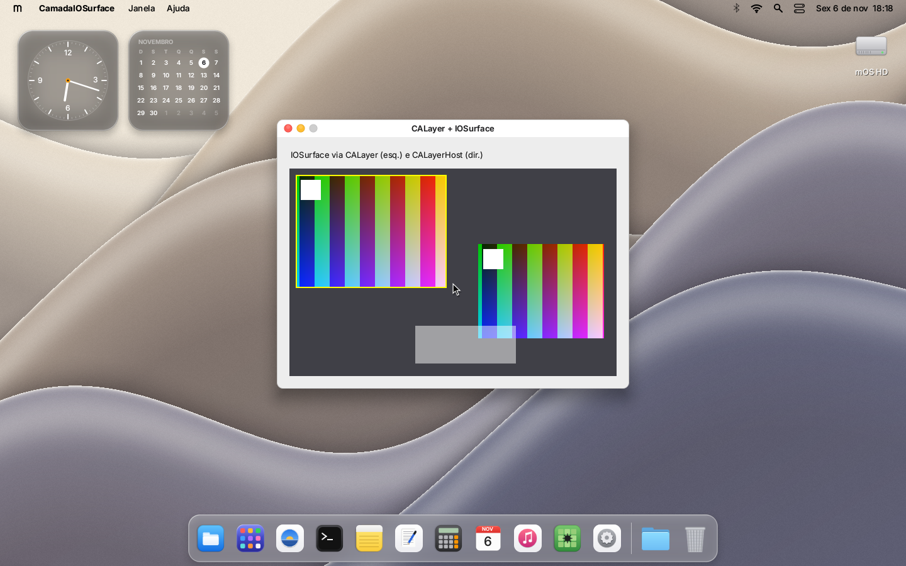

# Porte do VS Code para o mOS

Objetivo: rodar o **Visual Studio Code para macOS (Intel x64)**, sem modificações, como `/Aplicativos/VSCode.app`.
Versão usada nas medições: Code 1.145.2 (`com.microsoft.VSCode`), Electron/Chromium embutido.

## Onde estamos (6 nov. 2026)

| Etapa | Estado |
|---|---|
| Ler o bundle (`Info.plist`, executável) | ✅ o mOS reconhece o app como "Code 1.145.2" |
| Carregar o executável **e** as bibliotecas de dentro do app (`@rpath`, `@executable_path`, `@loader_path`) | ✅ 6 imagens, 207 MiB: `Code`, `Electron Framework`, `Squirrel`, `Mantle`, `ReactiveObjC`, `libffmpeg.dylib` |
| Ligar símbolos entre as imagens (export trie, reexports) e com o libSystem do mOS | ✅ |
| Registrar as classes Objective-C de todas as imagens | ✅ |
| Rodar os inicializadores e entrar no código do Chromium | ✅ |
| Base Mach/Darwin, `malloc` zones, `sysctl`, `CFRunLoop`, `dispatch_once`, `kqueue`, `mach_msg` (no processo) | ✅ (arquivos novos no libSystem, veja abaixo) |
| Threads do Chromium com TLS do macOS (`gs:[chave*8]`) e `thread_local` por thread | ✅ (kernel troca a base do GS por thread) |
| Node.js/libuv inicializa (pipes), telas enumeradas (`NSScreen`, `CGDisplay*`) | ✅ |
| Processo principal do VS Code estável no mOS | ✅ roda minutos sem chamar nenhuma função ausente e sem falhar |
| Código JS do VS Code (`Contents/Resources/app`) na imagem e executando, laço do AppKit (`-[NSApplication run]` de `nsurl.c` atendendo o CFRunLoop) | ✅ |
| Thread principal reconhecida (`pthread_main_np`, `+[NSThread isMainThread]`, `performSelectorOnMainThread:`, `CFRunLoopPerformBlock` no loop certo) | ✅ (antes toda thread "era a principal" e o Chromium rodava `[NSApp run]` na thread NetworkConfigWatcher, levando o V8 à thread errada) |
| Primeiro processo auxiliar (`Code Helper`, serviço de rede) lançado com `posix_spawn` | ✅ |
| Rendezvous Mach entre processos (`bootstrap_look_up ...MachPortRendezvousServer.<ppid>`) | ✅ (sessão "IPC Mach"; `getppid()` vem do kernel) |
| Laço do Node rodando (promessas de `fs`, timers): thread "embed" do Electron faz `poll()` no fd do kqueue do libuv | ✅ (`cx_kqueue_peek`; antes o `poll` nunca via o kqueue pronto e o JS parava no 1º `await`) |
| Módulos nativos `.node` do processo principal (`dlopen`) com o pedaço da libc++ que eles importam (`libcxx.c`) | ✅ policy-watcher, spdlog, sqlite3... (exceções C++ abortam com mensagem) |
| Startup completo do VS Code (serviços, storage, `lifecycle phase 2`, `windowsManager#open`, `window#ctor`) | ✅ |
| `new BrowserWindow` → `ElectronNSWindow` (moldura `NSThemeFrame`, cores do sistema, `NSColorSpace`, `@YES`) | ✅ |
| Memória compartilhada (`MAP_MEM_NAMED_CREATE`, `vm_map`, entradas só-leitura recusando escrita com `KERN_INVALID_RIGHT`) | ✅ (sessão "IPC Mach") |
| Fontes: `NSFont`/`CTFont` (métricas, descritores, coleções; `coretext.c`) | ✅ métricas e glifos (`CTFontDrawGlyphs` rasteriza num `CGBitmapContext`) |
| **Janela do VS Code na tela** (`ElectronNSWindow` 1200×800, fundo do tema, menu do app, ícone no Dock) | ✅ 6 nov. 2026 20:31 — `build-vscode\shots\janela-vscode-primeira.png` |
| Processo de renderização (`Code Helper (Renderer)`) e conteúdo da janela | ❌ o renderer passa do sandbox (`sandbox_check`/Seatbelt aceitos em darwin.c), da memória protegida (`mach_vm_region` real, sessão IPC Mach) e chega ao `RenderThreadImpl` (thread "Compositor"); num ciclo longo saiu sozinho ~2,5 min depois, sem falha; noutro ainda estava vivo aos 240 s. Conteúdo ainda vazio |
| Conteúdo de janelas CoreAnimation/IOSurface na tela (CALayer, CALayerHost, IOSurface por porta Mach) | ✅ no mesmo processo e entre processos (CAContext publicado; seção "CoreAnimation e IOSurface") |

No Terminal do mOS:

```
visitante@mOS ~ % macinfo /Aplicativos/VSCode.app
...
Veredito: modo experimental — carrega, mas para na primeira chamada a uma das 2076 funções ausentes
→ abre só no modo experimental (para na 1ª função que o mOS não tem)
visitante@mOS ~ % run /Aplicativos/VSCode.app
[3] /Aplicativos/VSCode.app iniciado (app do macOS, ring 3)
dyld[mOS]: símbolo não implementado no libSystem do mOS: _pthread_mach_thread_np
```

### Terminal integrado: pseudoterminais (7 nov. 2026)

**Funciona no VS Code** (QEMU com WHPX, `tools\vscode-teste.ps1 -ComBash`): a paleta "Terminal: Create New Terminal"
oferece o perfil `bash -l`, o pty host abre o par, o `spawn-helper` adota `/dev/ttys001` como terminal de controle e
faz `execve` do bash; o painel mostra o prompt `bash-5.3$`, `ls /` lista `Aplicativos Users private usr Sistema Volumes
tmp`, `echo ola-$((40+2))` dá `ola-42`, `stty size` dá `13 43` e, com a barra lateral fechada (⌘B, painel mais largo),
`13 69`; `sleep 30` + ^C volta ao prompt. O ambiente do shell de login volta a ser lido (`getUnixShellEnvironment#result`
cheio). Na primeira partida o diálogo de boas-vindas do Copilot fica na frente e engole as teclas: feche-o ("Continue
without Signing In", em 1070,673 na captura de 1440x900) antes de abrir o terminal. Capturas em `build-vscode\shots\`
(`vs-bash.png`, `vs-cmds3.png`, `vs-ctrlc3.png`, `vs3-cmds.png`).

**Fonte monoespaçada (7 nov.)**: as letras do terminal saíam espaçadas ("b a s h - 5 . 3 $"). O "Menlo" do mOS era a
Inter, proporcional, só marcada "mono", e o xterm.js mede a célula pelo "W". Agora a JetBrains Mono (SIL OFL 1.1,
`root/mOS/Sistema/Biblioteca/Fontes/JetBrainsMono-Regular.ttf` + `JetBrainsMono-OFL.txt`) faz o papel do Menlo:
- `userland/libsystem/fontmono.c` a registra no kernel na primeira vez que um `NSFont` monoespaçado é criado;
- o `ft_make` do `appkit.c` usa essa face para Menlo, Monaco, Courier, Consolas, SF Mono e
  `monospacedSystemFontOfSize:`, inclusive pelo `-[NSFontManager fontWithFamily:...]`.

O terminal fica numa grade alinhada (`build-vsmono\shots\vs-mono2.png`). Para os passos, prefira ⌘P com
`>Terminal: Create New Terminal`, porque o ⌘⇧P pelo QMP às vezes abre a busca de arquivos.

O terminal integrado do VS Code (e do Cursor e do Claude, que usam o mesmo `node-pty`) precisa de PTY. O
`node-pty` 1.2.0-beta.18 do VS Code 1.145 faz, no *pty host* (um utility process do Electron): `posix_openpt` +
`grantpt` + `unlockpt` + `ioctl(TIOCPTYGNAME)`, `open(escravo, O_RDWR | O_NOCTTY)`, `tcsetattr` e `TIOCSWINSZ` no
escravo, e `posix_spawn` do `spawn-helper` (dentro de `node_modules.asar.unpacked/node-pty/build/Release/`) com
`POSIX_SPAWN_SETSID | CLOEXEC_DEFAULT | SETSIGDEF | SETSIGMASK` e `dup2` do escravo para 0/1/2. O helper faz
`close(open(ttyname(0), O_RDWR))` (adota o terminal de controle), `chdir` e `execvp` do shell. O mestre fica
`O_NONBLOCK`; a leitura é um `tty.ReadStream` do libuv (EVFILT_READ no kqueue do libSystem), a escrita é `fs.write`
no threadpool (EAGAIN = tenta de novo), a saída do filho vem por `kqueue` EVFILT_PROC + `waitpid`, o redimensionamento
é `ioctl(mestre, TIOCSWINSZ)` e o título da aba é `tcgetpgrp(mestre)` + `sysctl(KERN_PROC_PID)` (`p_comm`).

**Kernel** (`kernel/proc/pty.c`, novo; ganchos em `process.c`, ABI em `syscall.h`):
- `SYS_OPEN("/dev/ptmx")` cria um par (até `MOS_PTY_MAX` = 64) e devolve o mestre; `/dev/ttysNNN` abre o escravo
  depois do `TIOCPTYUNLK`; `/dev/tty` abre o terminal de controle (ENXIO sem ele). Os fds ganham os tipos
  `FD_PTY_M`/`FD_PTY_S` e uma referência ao par (`fds[].pty`, contada em `fd_close`/`fd_copy`/fork/spawn/fileports).
- Disciplina de linha: ICANON (ERASE com IUTF8, KILL, WERASE, REPRINT, LNEXT, EOF, EOL), ECHO/ECHOE/ECHOK/ECHOKE/
  ECHOCTL/ECHONL, ISIG (^C, ^\ e ^Z viram sinais para o grupo em primeiro plano, com flush), ICRNL/INLCR/IGNCR/
  ISTRIP, IXON/IXANY, IMAXBEL, OPOST/ONLCR/OCRNL, VMIN/VTIME no modo cru. Trocar de canônico para cru entrega a linha
  pendente; de cru para canônico, a entrada crua não lida é reeditada (como o PENDIN do BSD).
- `struct termios` e os pedidos de `ioctl` com os números do macOS (`TIOCGETA`/`TIOCSETA[WF]`, `TIOCGWINSZ`/
  `TIOCSWINSZ` com SIGWINCH, `TIOCSCTTY`/`TIOCNOTTY`, `TIOCGPGRP`/`TIOCSPGRP`, `TIOCGSID`, `FIONREAD`, `TIOCOUTQ`,
  `TIOCSTI`, `TIOCFLUSH`, `TIOCSTOP`/`TIOCSTART`, `TIOCPTYGRANT`/`TIOCPTYUNLK`/`TIOCPTYGNAME` só no mestre, como o
  libuv espera para distinguir mestre e escravo).
- Sessões e grupos POSIX: `process_t` ganhou `pgid`, `sid` e `ctty`, herdados no fork/spawn; filhos do kernel e do
  init começam a própria sessão (como os jobs do launchd); `POSIX_SPAWN_SETSID`/`SETPGROUP` valem. Um líder de sessão
  sem terminal que abre um escravo sem `O_NOCTTY` o adota. `SYS_TTY` (56) tem `MOS_TTY_IOCTL`, `NAME`, `SETFL`
  (O_NONBLOCK no kernel), `SETSID`, `SETPGID`, `GETPGID`, `GETSID`, `KILLPG` e `PROCINFO`.
- Espera: read sem dados e write com a fila cheia bloqueiam a thread (`wait_pid = -9`, `thread_t.pty_wait`,
  zerado na entrada de toda syscall), salvo com `MOS_O_NONBLOCK`; cada mudança no par conclui as operações pendentes.
  `fstat` de um terminal: `is_dir = 5`, `size` = bytes que um read devolve agora, `mtime = 1` se daria fim de arquivo.
- Fim de linha: fechar o último mestre manda SIGHUP ao líder da sessão (e ao grupo em frente); o escravo lê 0 e
  escreve EIO. Sem nenhum escravo aberto, o mestre lê fim de arquivo (o node-pty fecha o terminal assim). O líder
  de sessão que sai manda SIGHUP ao grupo em frente e a sessão perde o terminal.
- Sinais de parada e de aviso (STOP, TSTP, TTIN, TTOU, CONT, WINCH, URG, INFO, IO) são ignorados por padrão (o mOS
  não para processos; antes o ^Z ou um redimensionamento encerravam o programa), e um sinal ignorado some sem acordar
  a thread com EINTR.

**libSystem** (`userland/libsystem/pty.c`, novo): `posix_openpt`/`grantpt`/`unlockpt`/`ptsname(_r)`/`openpty`/
`forkpty`/`login_tty`, termios inteiro (`tcgetattr`, `tcsetattr`, `cfmakeraw`, `cf*speed`, `tcflush`, `tcdrain`,
`tcflow`, `tcsendbreak`, `tcgetwinsize`), `isatty`/`ttyname(_r)`/`ctermid`, `setsid`/`setpgid`/`getpgid`/`getpgrp`/
`getsid`/`tcgetpgrp`/`tcsetpgrp`/`tcgetsid`/`killpg`, `cx_tty_ioctl` (o `ioctl` de `libc.c` manda para lá o que não
é FIONBIO/FIOCLEX), `kill(0, s)`/`kill(-pg, s)` de grupo, e o `sysctl(KERN_PROC_PID)` com nome, grupo e terminal
(`cx_kinfo_proc`, chamado de `darwin.c`). Os stubs antigos saíram de `cli.c`, `posixmore.c`, `vscode_libc.c`,
`extra.c` e `libc.c`. `open` passa `O_NOCTTY`/`O_NONBLOCK` ao kernel e `fcntl(F_SETFL)`/`FIONBIO` o avisam; o
`poll`/`select` voltam com EINTR quando um tratador de sinal roda (o readline do bash trata ^C e SIGWINCH assim). O
console do mOS (fds 0–2 fora da tabela do kernel) continua como antes: é terminal se `TERM` não é `dumb`, e o nome
falso passou a `/dev/console` (não colide com `/dev/ttys000`).

**Testes**
- `tools/ptytest.c`, no Windows, com o `pty.c` do kernel e processos/threads simulados: `ptytest: 82/82 ok`
  (`zig cc -target x86_64-windows-gnu -O1 -Ikernel/include tools/ptytest.c -o build/ptytest.exe`).
- `tools/build-ptytest.ps1 -OutDir build-pty` (`userland/tests-pty/main.c`, compila igual no macOS): o caminho do
  node-pty com o próprio binário como spawn-helper e um filho que confere sessão, terminal de controle, eco, SIGWINCH
  e ^C; depois o bash do Homebrew interativo (prompt, aritmética, `ls`, `tty`, `stty size`, `$COLUMNS` depois do
  TIOCSWINSZ, ^C num `sleep`, `exit 0`). O `-ComBash` do `stage-vscode.ps1` agora põe também `ls`, `cat`, `stty`,
  `tty` e `sleep` do coreutils. **No QEMU (WHPX, SMP, 512 MB): `ptytest: 44/44 ok` em três rodadas seguidas**, com o
  SIGWINCH respondido em 2–23 ms. O que o mestre leu do bash:

```
PTY$ echo ola-$((40+2))
ola-42
PTY$ cd / && ls
Aplicativos  Sistema  Users  Volumes  private  tmp  usr
PTY$ tty; stty size
/dev/ttys000
24 80
PTY$ echo cols=$COLUMNS lines=$LINES        (depois de TIOCSWINSZ 33x111: o readline redesenha em 111 colunas)
cols=111 lines=33
PTY$ ^C
PTY$ exit
```

- Achado no caminho: o `stat()` do libSystem abria o arquivo para procurar o marcador de link do mOS (`peek_file`);
  em `/dev/ptmx` isso criaria um par e em `/dev/ttysNNN` adotaria o terminal e esperaria digitação. `/dev/*` não é
  mais aberto ali.
- Achado no VS Code: o `spawn-helper` do node-pty é um executável com alvo antigo (`LC_UNIXTHREAD`, sem `LC_MAIN`) e o
  carregador o recusava ("sem LC_MAIN"); o pty host então abortava (o `Napi::Error` do node-pty é uma exceção C++, e
  o libSystem ainda não desenrola exceções) e o VS Code o relançava em laço. `kernel/compat/macho.c` agora entra
  pelo `_main` exportado quando só há `LC_UNIXTHREAD` (o `cx_start` faz o papel do `start` do crt1).
- Achado no VS Code: a ação `dup2` do `posix_spawn` copiava o `FD_CLOEXEC` do pai. O libuv marca CLOEXEC nas pontas
  dos pipes de stdio, então o filho perdia o stdout no próprio `execve`: o `bash -ilc 'Code -p ...'` que o VS Code usa
  para ler o ambiente do shell de login escrevia o JSON no console e o resultado vinha `{}`. `spawn_apply_fds`
  (process.c) limpa a marca como o `dup2` (teste "pipe de stdio com CLOEXEC" do PtyTest, 45/45).
- O `-ComBash` também põe `uname` e `sed`: o script de integração de shell do VS Code chama os dois a cada prompt, e sem
  eles cada comando mostrava "sed: command not found" e "history: write error" (o `history 1 | sed ...` perdia o
  leitor: EPIPE, que o `strerror` do libSystem também não conhecia e agora diz "Broken pipe"). Com os dois, o terminal
  fica limpo e as marcas de comando da integração de shell aparecem.
- Em aberto, fora do PTY: o xterm.js desenha as letras do terminal espaçadas demais (medida da fonte monoespaçada no
  renderer).

### Estado em 7 nov. 2026, 02:40 (sessão pausada)

- Janela do VS Code abre e o processo principal fica vivo; o `Code Helper (Renderer)` sobe e não cai mais nos CHECKs
  de sandbox (renderer exige estar em Seatbelt: `sandbox_check(getpid(), NULL)`) nem de `base::ProtectedMemory`
  (`mach_vm_region` com a proteção registrada; offsets no helper usam a base `0x400001040000`).
- Em aberto: por que o renderer sai (~2,5 min, sem falha) ou não entrega quadro. Para investigar: o kernel registra
  `proc: Code Helper ... chamou exit(N)` com a pilha (process.c, ligado por `despejar-threads`); rode
  `tools\vscode-teste.ps1 -Persist -Ocioso 300 -Limite 1200` e procure "chamou exit". O renderer estava inicializando o
  canal de GPU (`EstablishGpuChannel`) / compositor quando foi visto pela última vez.
- Correções mínimas feitas em arquivos de outras sessões para destravar o build comum: `coregraphics.c` (campo `cb`
  repetido → `cbt`/`rel_cb`), `xpc.c` (`sync_wait` declarado em `xconn_t`; dono desconhecido — conferir).
### Janela aberta (6 nov. 2026, 20:31)

O processo principal do VS Code abre a `BrowserWindow`: a janela aparece no mOS com o fundo do tema, título, botões e
o menu do app na barra; o processo principal continua vivo e lança o `Code Helper (Renderer)`. O conteúdo (o workbench)
ainda não aparece porque o renderer cai ao iniciar (`Electron Framework+0x1B24D59`, thread principal do pid 5) —
próximo passo. Depois da etapa abaixo vieram: entradas de memória só-leitura (`CheckPlatformHandlePermissionsCorrespondToMode`
espera `KERN_INVALID_RIGHT` ao mapear com escrita; sessão IPC Mach), `objc_msgSend_stret` nos meus envios que devolvem
`NSRect`, e `coretext.c` (73 símbolos de CoreText; `NSFont` = `CTFont`).
### Etapa anterior (6 nov. 2026, 20:00)

O VS Code passa por todo o startup do processo principal — o log `[main ...]` aparece na serial (`--verbose`) até
`window#ctor` — e o `ElectronNSWindow` é criado. Em seguida o Chromium mapeia memória compartilhada
(`Electron+0x7D9200`: `vm_map` + `vm_deallocate`) e o resultado cai num CHECK (`Electron+0xE3F7C8`). Causa: o
Chromium cria a região com `mach_make_memory_entry_64(..., offset 0, MAP_MEM_NAMED_CREATE | RW, ...)` (região nova,
zerada), e o mOS trata `offset` como endereço a copiar. Pedido à sessão "IPC Mach" (mach.c / kernel machipc.c).

Corrigido nesta etapa (em ordem):

1. Thread principal: `pthread_main_np` e `+[NSThread isMainThread]` diziam sempre "sim"; o Chromium rodava `[NSApp run]`
   na thread NetworkConfigWatcher (V8 sem isolate, `Electron+0xBF0A4A`). Também `performSelectorOnMainThread:` (fila
   principal do GCD), `CFRunLoopPerformBlock` (no loop pedido) e `getppid()` real.
2. Laço do Node: a thread "embed" do Electron espera com `poll(uv_backend_fd)`; `poll` não sabia que um kqueue fica
   legível com evento pronto → `kqueue.c: cx_kqueue_peek`, usado por `poll` e pelo novo `select` (`darwin.c`).
3. Módulos nativos: `stage-vscode.ps1 -ComModulosNativos` copia com `\\?\` (caminhos > 260 caracteres, ex.:
   `vscode-policy-watcher.node`); `libcxx.c` implementa os 62 símbolos de libc++/libc++abi que esses módulos importam.
4. `os_unfair_lock` era no-op (extra.c): o PartitionAlloc corrompia a freelist com várias threads — era o CHECK
   intermitente "slotsize/entrypos" (`Electron+0x5F3F9AD`). `pthread_threadid_np` devolve o tid real.
5. Janela: `NSThemeFrame` (moldura devolvida por `-superview` da view de conteúdo, para o swizzling de `swipeWithEvent:`),
   `__kCFBooleanTrue/False` como objetos (`@YES` era um ponteiro para ponteiro), cores do sistema que faltavam,
   `NSColorSpace`, `NSScreen colorSpace`, getters de `NSWindow`, `NSEqualRects`/`NSIntersectionRect`/... (cgdisplay.c),
   `@{}`/`@[]` vazios (`___NSDictionary0__`/`___NSArray0__`, literals.c).

Diagnóstico novo:

- `/Sistema/Biblioteca/despejar-threads` (posto por `stage-vscode.ps1 -Diagnostico`): o kernel despeja a cada 30 s, no
  log serial, cada thread de usuário com estado, `rip`/`rsp` e endereços de código na pilha ("despejo:"); serve para
  achar onde o app ficou parado sem falhar. `proc_fault` também imprime textos legíveis apontados pela pilha.
- `tools/vscode-teste.ps1 -Persist`: o disco não é descartável (lê-se depois o que o app gravou, ex.: logs do VS Code).
- Endereços no Electron: offset = endereço − `0x400001010000`; `__TEXT`/`__DATA` têm vmaddr = offset no arquivo, então
  seletores e strings perto de um endereço saem lendo `__objc_selrefs` (rebase de chained fixups: 36 bits baixos).
## Tamanho do que falta (medido com `tools/machocheck.c`)

Caminho crítico (o que o executável `Code` carrega ao abrir):

- **65** bibliotecas do sistema pedidas; **55** não existem no mOS (IOKit, Security, IOSurface, Metal, CoreVideo,
  CoreMedia, AVFoundation, SystemConfiguration, CFNetwork, CoreServices, Carbon, libcups...).
- **6.038** imports; **2.273** sem implementação (**2.017** funções distintas). Os maiores grupos:
  libSystem 371, AppKit 293, CoreFoundation 173, CoreGraphics 149, Security 100, IOKit 75, ApplicationServices 75,
  CoreText 73, CoreVideo 65, CoreMedia 53, libcups 51, Foundation 45.
- O libSystem do mOS exporta hoje 866 símbolos.

O bundle inteiro (com helpers, `.node` nativos, ripgrep, Copilot etc.) tem 46 imagens Mach-O, 81 bibliotecas do
sistema e 5.955 imports sem implementação.

## O que já foi feito no libSystem e no kernel (6 nov. 2026)

Arquivos novos em `userland/libsystem/` (todos documentados no cabeçalho):

| Arquivo | Conteúdo |
|---|---|
| `mach.c` | portas (nomes), `pthread_mach_thread_np`, `vm_page_size`, `mach_vm_region`, semáforos Mach, `mach_msg` dentro do processo, `notify(3)`, IOKit mínimo, SIP |
| `mzone.c` | `malloc_zone_t` com o layout real (o Chromium troca os ponteiros da zona padrão) |
| `darwin.c` | UTF-8 (`mbtowc`...), `os_log` desligado, `sysctl`/`sysctlbyname` (mOS se apresenta como Darwin 23 / macOS 14), atributos de pthread, `getrlimit`, constantes `CFString` reais, ponte CFString/CFBundle/CFDictionary, `thread_local` por thread (`cx_tlv_get`) |
| `tlv.S` | `cx_tlv_bootstrap`, o thunk de TLV que preserva todos os registradores |
| `nsurl.c` | `NSURL` (arquivos), `CFURL*`, `NSBundle` por URL, `NSThread`, `NSProcessInfo` (versão, estado térmico) |
| `literals.c` | literais constantes do Xcode 15+ (`@{}`, `@[]`, `@42` em `__objc_dictobj`...) |
| `dispatch.c` | `dispatch_once` completo; filas, `async`/`sync`/`after` executando na hora |
| `cfrunloop.c` | `CFRunLoop` por thread: fontes, timers, observadores, `RunInMode`, `WakeUp` |
| `kqueue.c` | `kqueue`/`kevent64` no processo: `EVFILT_USER`, `MACHPORT`, `TIMER`, `WRITE` |
| `cgdisplay.c` | `CGDisplay*` e métodos de `NSScreen` |

Mudanças em arquivos que já existiam: `foundation.c` (NSBundle por instância), `extra.c` (`mmap` com reserva/`mprotect`,
TSD por thread via GS, `pthread_cond_timedwait` com prazo), `libc.c` (`pipe` real, `abort` informa quem chamou),
`objc.c` (ganchos `cx_darwin_init` e `cx_darwin_literals`, feitos pela sessão dona do runtime).
Kernel: `SYS_MMAP` com reserva (`b=1`) e alocação de trecho (`b=2`); `thread_t.gs_base` com `CR4.FSGSBASE` e troca do
`IA32_GS_BASE` em `switch_to`; `/Sistema/Biblioteca/stderr-serial` copia a saída dos apps para o log serial.

Diagnóstico: `tools/stage-vscode.ps1 -Diagnostico` liga `/Sistema/Biblioteca/dyld-registrar` (funções ausentes avisam e
devolvem 0 em vez de encerrar) e o `stderr-serial`. `tools/machocheck.c --calls <imagem> <endereço>` lista as chamadas a
imports perto de um endereço (para achar quem chamou `abort`); `--sym <libSystem.mos> <endereço>` simboliza falhas no libSystem.

## Roteiro (ordem em que o Electron vai precisar)

Feito: itens 1 e 2 (com as limitações acima) e a parte de reserva de memória do item 3. Próximos, nesta ordem:
pôr `Contents/Resources/app` na imagem (precisa de mais RAM ou de arquivos lidos do disco sob demanda), `dlopen` de
módulos nativos `.node` (`MH_BUNDLE`), processos auxiliares com IPC Mach entre processos, e a janela (AppKit + IOSurface).

1. **Base Darwin/Mach no libSystem**: `pthread_mach_thread_np`, `mach_task_self`, `mach_port_allocate/insert_right/deallocate`,
   `task_info`, `thread_info`, `mach_absolute_time`/`mach_timebase_info`, `vm_allocate`/`mach_vm_*`, `sysctl`/`sysctlbyname`,
   `_NSGetExecutablePath`, APIs do dyld (`_dyld_image_count`, `_dyld_get_image_header`, `dladdr`, `dlopen`/`dlsym` para as
   bibliotecas do bundle). É o que o próximo `run` vai pedir, uma a uma.
2. **Threads e sincronização completas** (o Chromium sobe dezenas de threads): pthreads, variáveis de condição, chaves TLS,
   e o TLS por thread no carregador (hoje o modelo é de uma thread só).
3. **Memória para o V8**: reservar muito espaço virtual sem ocupar RAM (a "gaiola" de ponteiros comprimidos reserva 4 GiB),
   `mmap` com proteções, `mprotect`, `MAP_JIT` (código executável gerado em tempo de execução). Exige paginação sob demanda.
4. **Arquivos do app no disco, não na RAM**: hoje `\mOS\` inteiro é copiado para a RAM no boot. Com `Resources/` (pacotes
   `.pak`, `icudtl.dat`, snapshot do V8, o código JS do VS Code) o app passa de 400 MB.
5. **Multiprocesso**: o Electron abre os helpers (`Code Helper (GPU/Renderer/Plugin).app`) com `posix_spawn` e conversa com
   eles por portas Mach. Precisa de IPC Mach (ou um equivalente) entre processos, sockets `AF_UNIX`, `kqueue`, `poll`.
6. **Gráficos**: o caminho mais curto é desligar a GPU (`--disable-gpu`) e usar composição por software com o SwiftShader
   que já vem no bundle, entregando os quadros por um IOSurface "falso" ligado às janelas do mOS; mais CoreAnimation mínimo.
7. **Frameworks**: CoreFoundation, Foundation e AppKit bem mais completos (janelas, eventos, menus), CoreText para fontes
   (o Skia do Chromium usa CoreText no macOS), CoreGraphics; Security/SystemConfiguration/IOKit podem começar como stubs
   que devolvem "não disponível".
8. **Node.js** no processo principal e no *extension host* (mesmos requisitos de threads, sockets e memória).

Ordem de grandeza: meses de trabalho no libSystem e no kernel. O ganho desta etapa é que agora cada passo é medido
contra o binário real.

## Como reproduzir

```powershell
# baixe o VS Code para macOS (Intel): https://update.code.visualstudio.com/latest/darwin/stable, e extraia com tar -xf
# (os erros de "Can't create" do tar são só os links simbólicos dos frameworks; os binários reais ficam em Versions/A)
.\build.ps1 -OutDir build-vscode
.\tools\stage-vscode.ps1 -App "<pasta>\Visual Studio Code.app"
.\run.ps1 -Image build-vscode/mOS.img -Memory 2560
```

Sem QEMU, no Windows, com o mesmo `kernel/compat/macho.c`:

```powershell
zig cc -target x86_64-windows-gnu -O2 -DMOS_HOST_TEST -Ikernel/include -Itools tools/machotest.c tools/host_enter.S kernel/compat/macho.c -o build/machotest.exe
$env:MACHOTEST_TOLERANT = 1      # modo experimental (bibliotecas do sistema ausentes viram stubs)
$env:MACHOTEST_MAP = 1           # mostra onde cada imagem foi carregada
$env:MACHOTEST_STUB_LOG = 1      # stubs registram a chamada e devolvem 0 em vez de encerrar
$env:MACHOTEST_PATH = '/Visual Studio Code.app/Contents/MacOS/Code'
.\build\machotest.exe build\libSystem.mos "<pasta que contém o .app>" "<pasta>\Visual Studio Code.app\Contents\MacOS\Code"
```

Inventário completo de imports ausentes por biblioteca:

```powershell
zig cc -O2 -target x86_64-windows-gnu tools/machocheck.c -o build/machocheck.exe
.\build\machocheck.exe build\libSystem.mos "<pasta>\Visual Studio Code.app" faltando.txt
```

## O que mudou no carregador para chegar aqui

`kernel/compat/macho.c` virou um "mini-dyld":

- carrega `MH_DYLIB` de dentro do bundle, resolvendo `@rpath` pelos `LC_RPATH` da imagem e do executável, com
  `@executable_path`/`@loader_path`; num `.framework`, procura também em `Versions/A` e `Versions/Current` (o FAT32 não tem
  links simbólicos);
- liga os símbolos pela export trie de cada imagem (com reexports) antes de procurar no libSystem;
- monta todas as imagens em sequência a partir de `0x400001000000` e roda os inicializadores na ordem de dependência;
- passa ao runtime as seções Objective-C de todas as imagens;
- classe Objective-C que o mOS não tem é ligada a `NSObject` (antes virava um stub de código e o runtime caía ao ler o isa);
- **modo experimental**: se `/Sistema/Biblioteca/dyld-experimental` existir, bibliotecas do sistema que o mOS não tem não
  impedem o app de abrir; as funções delas encerram o processo dizendo o nome (`dyld[mOS]: símbolo não implementado...`).
  Sem o arquivo, o comportamento é o de antes: o app é recusado com a lista do que falta.

## dlopen em tempo de execução (6 nov. 2026)

O Node.js carrega os módulos nativos (`.node`, `MH_BUNDLE`) com `dlopen` + `dlsym("napi_register_module_v1")`, e o
executável do Google Chrome faz `dlopen` do "Google Chrome Framework" + `dlsym("ChromeMain")`. Agora isso funciona:

- **Kernel** (`kernel/compat/macho.c`): o grafo de imagens (`link_t`) não é mais liberado no fim do `macho_load`; fica em
  `process_t.dyld` até a última thread sair (`free_address_space`) e é copiado no `fork`. Os comandos de carga e a export trie
  de cada imagem passam para uma cópia do kernel (`image_persist`): o arquivo no VFS pode ser regravado sem deixar ponteiros
  soltos. `MAX_IMAGES` foi para 96.
- **Syscall `SYS_DYLD` (42)**, operações `MOS_DYLD_*` em `kernel/include/syscall.h`:
  - `OPEN` carrega `MH_DYLIB` ou `MH_BUNDLE` com as dependências do bundle, resolvendo `@rpath` (LC_RPATH da imagem que pediu e
    do executável), `@loader_path` (relativo a quem chamou o dlopen) e `@executable_path`. As imagens novas vão para a região de
    mmap do processo (`p->mmap_next`, acima de 4 GiB), recebem os fixups (chained ou dyld_info) contra todas as imagens já
    carregadas + libSystem e ganham uma **área de stubs própria** (zeros para constantes ausentes, registros TLS por imagem,
    stubs de símbolos ausentes, inicializadores e seções ObjC). Mesmas regras da partida: biblioteca do sistema que o mOS não tem
    recusa o dlopen, salvo no modo experimental. `/usr/lib/libSystem.B.dylib`, `Foundation.framework` e afins devolvem um handle
    que procura só no libSystem. `RTLD_NOLOAD` procura entre as carregadas.
  - `SYM` procura pela export trie: handle = a imagem e as dependências dela (em largura) e depois o libSystem;
    `RTLD_DEFAULT` = todas as imagens na ordem de carga e depois o libSystem; também `RTLD_SELF`, `RTLD_NEXT`, `RTLD_MAIN_ONLY`.
    O `_` do Mach-O é acrescentado pelo kernel.
  - `CLOSE` (contador; nada é descarregado, como o dyld faz com imagens que têm ObjC/Swift), `COUNT`, `IMAGE` (cabeçalho +
    caminho), `FIND` (imagem que contém um endereço), `ERROR` (mensagem do último erro).
- **libSystem** (`userland/libsystem/dlfcn.c`): `dlopen/dlsym/dlclose/dlerror/dlopen_preflight`, `_dyld_image_count`,
  `_dyld_get_image_header/name/vmaddr_slide` e `_dyld_get_image_header_containing_address` (saíram de `extra.c`) cobrem as
  imagens da partida **e** as do dlopen (antes `_dyld_image_count` devolvia 1, só o executável). Para cada carga com imagens
  novas, na ordem do dyld: seções ObjC (`cx_objc_boot` → `cx_objc_init_image`, com +load), callbacks de
  `_dyld_register_func_for_add_image` (`dyldimg.c` agora guarda os callbacks; o runtime Swift acha as seções `__swift5_*`
  das imagens novas por aqui) e os inicializadores. `thread_local` das imagens novas usa os registros da área de stubs delas
  (`TLV_IMAGES` em `darwin.c` foi para 128).
- **Harness**: `tools/machotest.c` emula `SYS_DYLD` chamando o mesmo `macho_dyld_syscall`, e o mmap dele usa o mesmo
  `mmap_next` do carregador.
- **Teste**: `tools/build-dltest.ps1` monta `DLTest.app` (`userland/tests-dlopen/`): um `MH_BUNDLE` com construtor, classe ObjC
  com `+load`, `thread_local`, dependência `@rpath/libdep.dylib` e um símbolo do executável achado por busca plana (como os
  `.node` com `-undefined dynamic_lookup`). O app confere 23 itens; argumentos extras são `.node`/dylibs para carregar.

```powershell
.\tools\build-dltest.ps1 -Dest build\dltest
$env:MACHOTEST_PATH = '/DLTest.app/Contents/MacOS/DLTest'
.\build\machotest.exe build\libSystem.mos build\dltest build\dltest\DLTest.app\Contents\MacOS\DLTest     # dlopen-teste: 23/23 ok
# módulos reais do VS Code (copiados para build\dltest\node\), no modo experimental:
$env:MACHOTEST_TOLERANT = 1
.\build\machotest.exe build\libSystem.mos build\dltest build\dltest\DLTest.app\Contents\MacOS\DLTest /node/spdlog.node /node/pty.node
```

Resultado no harness: `spdlog.node`, `watchdog.node`, `pty.node` e `vscode-sqlite3.node` carregam, os inicializadores rodam e
`napi_register_module_v1` é achado. No mOS (QEMU, `build-dlopen`, DLTest iniciado por um LaunchDaemon com o `.node` de
`/Aplicativos/VSCode.app/.../node_modules.asar.unpacked` como argumento): `dlopen-teste: 24/24 ok` com `spdlog.node` e com
`pty.node` (o `init` corta `Argumentos` em 128 bytes: um módulo por serviço). O que falta para eles funcionarem de verdade não é do carregador: `libc++.1.dylib`
(~70–100 símbolos `std::__1` por módulo; sem o modo experimental o dlopen é recusado por isso) e, fora do Electron, a N-API
(`napi_*`), que no VS Code real vem do Electron Framework por busca plana. `tools/stage-vscode.ps1 -ComModulosNativos` copia
`node_modules.asar.unpacked` para a imagem (arquivos acima de `-MaxModuloMiB`, padrão 32, ficam de fora).

Limites conhecidos: `dlclose` não descarrega; `dladdr` (em `swiftsupport.c`) ainda não usa `MOS_DYLD_FIND`/a trie para dar o
nome da imagem e do símbolo; `RTLD_LOCAL` é tratado como global (busca plana).

## IPC Mach entre processos (portas Mach)

O Electron abre os `Code Helper (GPU/Renderer/...)` com `posix_spawn` e eles fazem *rendezvous* com o processo principal por
portas Mach (`base/apple/mach_port_rendezvous_mac.cc`): o principal registra `com.<bundle>.MachPortRendezvousServer.<ppid>` no
bootstrap e cada helper faz `bootstrap_look_up` e troca `mach_msg` com direitos de porta. Antes, as portas só existiam **dentro**
de um processo (filas em `mach.c`, bootstrap em `darwin.c`), então o helper caía em `bootstrap_look_up ... 1102` → "Mach rendezvous
failed". Agora há portas Mach **no kernel**.

**Kernel (`kernel/proc/machipc.c`, syscalls 80..95 em `kernel/include/syscall.h`).** Cada processo tem um espaço de nomes de
portas (`mspace_t`): nome (u32) → porta + direitos (receive / send com *urefs* / send-once / port set / nome morto). Uma porta
(`kport_t`) é fila de mensagens + contadores de direitos + conjunto + pedidos de notificação; também representa conjuntos de
portas, objetos do kernel (task 0x103, host 0x203, thread 0x1000+tid, bootstrap 0x303) e entradas de memória compartilhada.

- `SYS_MACH_MSG` — `mach_msg` completo. No envio, o kernel copia a mensagem e troca nomes por portas: o header (destino +
  direito de resposta) e, se `MSGH_COMPLEX`, os descritores — de porta (12 bytes), de memória *out-of-line* (16 bytes, copiada
  para páginas físicas próprias) e de vetores de portas. Enfileira no destino; quem recebe sem mensagem **bloqueia** (`TH_WAITING`,
  `wait_pid = -7`), com prazo acordado pelo escalonador (`wake_sleepers` em `sched.c`). Na recepção os direitos entram no espaço
  de quem recebe, a memória OOL é mapeada (páginas compartilhadas, contadas em `pref[]` como as de COW) e é acrescentado o
  *trailer* no tamanho pedido em `MACH_RCV_TRAILER_ELEMENTS` (bits 24..27 das opções: 0 → 8 bytes, 1 → 12, 2 → 20, 3+ → 52
  com o `audit_token`, que leva o pid de quem enviou — `audit_token_to_pid`, usado pelo rendezvous).
- `SYS_MACH_PORT` — `mach_port_allocate/deallocate/mod_refs/insert_right/extract_right/construct/destruct`, tipos e refs,
  conjuntos (`insert/move/extract_member`), notificações (`request_notification`: sem-remetentes e nome-morto), limites e
  contexto, status/peek/pending (o `cx_mach_pending` do kqueue consulta `MACH_OP_PENDING`), e as portas especiais da task
  (`task_get/set_special_port`, `posix_spawnattr_setspecialport_np` via `MACH_OP_SPAWN_SPECIAL`).
- `SYS_MACH_BOOTSTRAP` — registro de serviços **global** no kernel: `check_in` dá o direito de receber ao servidor, `look_up`
  dá um direito de enviar a quem procura, `register` publica um direito que o chamador já tem.
- `SYS_MACH_VM` — entradas de memória compartilhada (`mach_make_memory_entry_64` / `mach_vm_map`) que viajam como direito numa
  mensagem e são mapeadas nos dois processos (base::SharedMemory). Com `MAP_MEM_NAMED_CREATE` (0x20000) a entrada é um
  objeto novo e zerado; sem ele, as páginas já mapeadas em `[offset, offset+size)` do chamador. `mach_vm_map` com
  `VM_FLAGS_ANYWHERE` mapeia as **mesmas** páginas físicas (respeitando o deslocamento e a proteção). `vm_deallocate` ainda
  não desmapeia.
- **Herança**: filhos de `posix_spawn`/`fork` herdam o direito de bootstrap do pai (ou a porta dada a
  `posix_spawnattr_setspecialport_np`) — `machipc_spawn`, chamado em `proc_spawn_in` e no `fork` de `process.c`. `machipc_exit`
  derruba os direitos ao processo sair: portas sem receptor viram mortas e disparam as notificações pendentes.

**libSystem.** `userland/libsystem/mach.c` passou a ser o dono de `mach_msg`, `mach_port_*`, `bootstrap_*` e
`task_get/set_special_port` (a seção de bootstrap saiu de `darwin.c`), todos delegando às syscalls acima; os nomes especiais
(task/host/thread, semáforos, entradas de memória) continuam resolvidos no libSystem. O servidor do rendezvous escuta a porta
com `dispatch_source_create(DISPATCH_SOURCE_TYPE_MACH_RECV, ...)`: `userland/libsystem/dispatch.c` agora cria uma fonte de
verdade para esse tipo (uma thread espera na porta com `MACH_OP_WAIT` e dispara o handler — na fila principal via
`dispatch_async_f`, para o V8 rodar na thread certa); os outros tipos de fonte continuam `NULL`.

**Teste** (`userland/machtest.c`, programa nativo do mOS; rode `machtest` no Terminal): faz `fork`, o pai registra um serviço
(`check_in`) e o filho o encontra (`look_up`) e envia uma mensagem **complexa** — direito de resposta send-once no header, um
descritor de porta (transfere um send novo) e um bloco OOL com uma string; o pai confere tudo e responde, o filho confere a
resposta. Imprime `machtest: PASS`. (O harness sem QEMU `tools/machotest.c` não cobre este caminho: ele é do carregador Mach-O,
não do escalonador/portas; o teste roda no QEMU.)

Estado: `machtest: PASS` no QEMU (`build-ipc`, rodado por um LaunchDaemon para a saída ir à serial): check_in/look_up entre
processos, mensagem complexa com send-once + porta transferida + OOL, memória compartilhada (o filho cria uma entrada
`NAMED_CREATE` e manda a porta; o pai mapeia, lê e escreve; o filho vê a escrita do pai) e resposta. No ciclo integrado do VS
Code os `Code Helper` já passam do rendezvous.

## CoreAnimation e IOSurface: conteúdo da janela na tela (6 nov. 2026)

No macOS o Chromium não desenha a janela com `drawRect:`: o compositor (viz), mesmo por software (`--disable-gpu`), entrega cada
quadro num **IOSurface** e o processo do navegador o mostra numa árvore de **CALayer** pendurada na `NSView` da janela
(`ui::DisplayCALayerTree`: layer raiz da view → layer invertido de tamanho 0 com `autoresizingMask` Width|HeightSizable →
layer com `contents = IOSurface`, `contentsGravity = topLeft`, `contentsScale`; ou um `CALayerHost` com o `contextId` de um
`CAContext` do processo da GPU). O mOS não tinha QuartzCore nem IOSurface; agora tem, com composição por software.

Arquivos novos em `userland/libsystem/`:

| Arquivo | Conteúdo |
|---|---|
| `iosurface.c` | Classe `IOSurface` (IOSurfaceRef é ponte com ela: `CFRetain`/`CFRelease`), `IOSurfaceCreate` lendo o dicionário (largura, altura, bytes por linha/elemento, formato, `kIOSurfacePlaneInfo`, `AllocSize`), `Lock`/`Unlock` (com *seed*), `GetBaseAddress(OfPlane)`, `GetWidth/Height/BytesPerRow/...(OfPlane)`, `GetID`/`IOSurfaceLookup`, contagem de uso, `SetValue`/`CopyValue`, `SetPurgeable`, `AlignProperty`, as 23 constantes `kIOSurface*`; portas Mach (abaixo) |
| `quartzcore.c` | `CALayer` (bounds/position/anchorPoint/frame, `transform` com escala e translação, `sublayerTransform`, `zPosition`, sublayers, `contents` = IOSurface ou NSImage, `contentsRect/Scale/Gravity`, `opacity`, `hidden`, `masksToBounds`, `backgroundColor`, borda, `geometryFlipped`, `autoresizingMask`, `setNeedsDisplay`/`display` pelo delegate, conversão de pontos), `CALayerHost`, `CAContext` (`contextWithCGSConnection:options:`, `contextId`, `layer`), `CATransaction` (begin/commit/flush, `setDisableActions:`, bloco de conclusão), `CATransformLayer`, `CAMetalLayer`/`CAOpenGLLayer` (sem drawable), `CAEDRMetadata`, `CATransform3D*`, `CACurrentMediaTime`, `CGSMainConnectionID`, constantes `kCA*`; integração com o NSView e o compositor |
| `corevideo.c` | `CVDisplayLink` (uma thread a 60 Hz chama o callback, como no macOS), `CVPixelBuffer` sobre IOSurface (+ pool, anexos, `CreateWithBytes`), constantes `kCV*`; "sem GPU": `MTLCreateSystemDefaultDevice` = nil, `MTLCopyAllDevices` = vazio, `CGLChoosePixelFormat` = erro (o Chromium escolhe o SwiftShader/software) |
| `cfcollections.c` | Coleções do CoreFoundation em ponte com o Foundation do mOS: `CFDictionaryCreate(Mutable)(Copy)`, `Set/Add/Replace/RemoveValue`, `ApplyFunction`, `GetKeysAndValues`; `CFArrayCreate(Mutable)(Copy)`, `Append/Insert/Set/RemoveValue`, `ApplyFunction`; `CFNumberCreate/GetValue/IsFloatType`, `CFBooleanGetValue`; `CFGetTypeID` e os `*GetTypeID` com os números da Apple (String 7, Null 16, Dictionary 18, Array 19, Data 20, Boolean 21, Number 22, URL 29, UUID 34, Date 42); `kCFType*CallBacks` |

**Como o conteúdo chega à tela.** `NSView` ganha `wantsLayer`/`setWantsLayer:`/`layer`/`setLayer:`/`makeBackingLayer` (a ligação
view → layer fica numa tabela do `quartzcore.c`; o estado das views continua do `appkit.c`). O `appkit.c` chama
`cx_layer_draw_hook` (gancho marcado "gancho QuartzCore") em `draw_view_tree`: fase 0 antes do desenho da view (fundo do layer
raiz) e fase 1 depois do `drawRect:` (conteúdo e sublayers), antes das subviews. Na fase 1 a árvore é achatada num buffer ARGB
pré-multiplicado do tamanho da área visível da view (já recortada pelo clip do AppKit), com mapa afim por eixo (y para cima ou
para baixo conforme `isFlipped`/`geometryFlipped`), amostragem por vizinho mais próximo e composição *over* com opacidade. O
QuartzCore despacha o lote pendente do AppKit (`cx_gui_flush`, que repõe o recorte vigente — o kernel zera o clip a cada
`GUI_DRAW`) e manda o buffer em faixas `GC_IMAGE` de menos de `GUI_MAX_BATCH` (512 KiB), pulando faixas transparentes.
Redesenho: qualquer mudança num layer e todo `IOSurfaceUnlock` de escrita marcam a view hospedeira com `setNeedsDisplay:` (de
qualquer thread: só liga a flag), e o laço do AppKit redesenha. Sem animações (tudo vale na hora, como `setDisableActions:YES`).

**IOSurface entre processos.** A memória de um surface é uma página de cabeçalho (`surf_hdr_t`: tamanho, formato, planos)
seguida dos pixels. `IOSurfaceCreateMachPort` cria uma **entrada de memória** do kernel (`mach_make_memory_entry_64`, da sessão IPC
Mach) sobre o bloco e põe marca|pid|id no contexto da porta; cada chamada devolve um direito novo, que o chamador desaloca, como
no macOS. `IOSurfaceLookupFromMachPort`: se a porta é deste processo (contexto), devolve o mesmo objeto; senão mapeia a entrada
(`mach_vm_map`), lê o cabeçalho e monta um IOSurface que enxerga os **mesmos pixels** — é o caminho do `Code Helper (GPU)` para o
processo principal. Sem IPC no kernel (harness `machotest`), a porta é o nome local `0x7F000000 | id`. Um `CALayerHost`
mostra a árvore viva de um `CAContext` do mesmo processo. Entre processos o dono achata a árvore num buffer compartilhado
(`MACH_VM_CA_PUBLISH` em `machipc.c`) e o host do outro processo o desenha; o `pump` do AppKit pede redesenho quando a
geração muda. É o caminho remoto do Chromium (`ca_context_id`), o mais comum com GPU. Por software ele ainda pode mandar
o IOSurface (`CALayerParams.io_surface_mach_port`). `class_getProperty` acha `contextId` e `layer`, então
`RemoteLayerAPISupported` passa. `createFencePort` devolve um direito de envio; o commit não espera a cerca.

**Teste** (`userland/testes/CamadaIOSurface/main.m`, compila igual no macOS): `NSWindow` + `NSTextField` + `NSView` com
`wantsLayer`, layer raiz cinza, um sublayer com `contents` = IOSurface 240×180 BGRA pintado à mão (degradê, faixas que andam a
cada 0,5 s, quadrado branco no canto superior esquerdo para conferir a orientação, borda amarela), um layer invertido com
autoresize (como o do Chromium) contendo um `CALayerHost` que mostra um `CAContext` cujo layer tem outro IOSurface recebido por
`IOSurfaceCreateMachPort`/`LookupFromMachPort`, e um véu branco com `opacity` 0,5 por cima.

```powershell
.\tools\build-camada-teste.ps1                         # build\testes\CamadaIOSurface.app
.\build.ps1 -OutDir build-ca; .\tools\build-camada-teste.ps1 -Imagem build-ca
.\tools\qemu-test.ps1 -OutDir build-ca -Port 5923 -Memory 768 -Steps "wait:40000;shot:camada"
```



No QEMU (captura acima) a janela mostra os dois IOSurfaces nas posições e na orientação certas, a animação redesenha a janela
e a porta do surface é uma entrada de memória do kernel. No harness (`tools/machotest.c`, `MACHOTEST_FRAMES=1`) os quadros saem
com `img`; os samples Lista, Formulario e Bloco dão saída idêntica com e sem o gancho (comparado com um libSystem compilado com
`-DQC_SEM_GANCHO`, que desliga o `cx_quartzcore_init`).

Medido com `tools/machocheck.c` no bundle inteiro do VS Code: QuartzCore 21 imports / **0** ausentes, IOSurface 48 / **0**,
CoreVideo 65 / **0**, OpenGL 2 / 0; do Metal sobram só 19 classes `MTL*Descriptor` (o carregador as liga ao `NSObject`, e
`MTLCreateSystemDefaultDevice` = nil faz o Chromium não usá-las).

**Lição do carregador**: símbolos `__attribute__((weak))` do libSystem **não** são exportados aos apps (o `CGSMainConnectionID`
fraco virou "símbolo não implementado"); use definições fortes.

**Falta / próximos passos**
- Rodar o VS Code (`tools/vscode-teste.ps1 ... -OutDir build-ca -Port 5923`) até a janela e conferir os avisos
  `objc[mOS]: -[CALayer ...] ainda não implementado` no log: não deu nesta sessão por falta de RAM livre no host (0,5–0,9 GB
  livres; o VM do VS Code usa 2,7 GB).
- `CAContext` entre processos está no kernel (`MACH_VM_CA_*`): o quadro é a árvore achatada, não cada sublayer ao vivo.
- `CGImage` como `contents`, `cornerRadius`, sombra, `mask` e rotação entram no desenho. Filtros Core Image e
  formatos de 8 bytes (`RGhA`, `l10r`) continuam de fora. A amostragem linear vale quando a escala não é 1:1.
- `@{}` vazio compilado pelo Xcode 15+ usa o símbolo `___NSDictionary0__`, que o libSystem não exporta (o app de teste usa
  `[NSDictionary dictionary]`).
