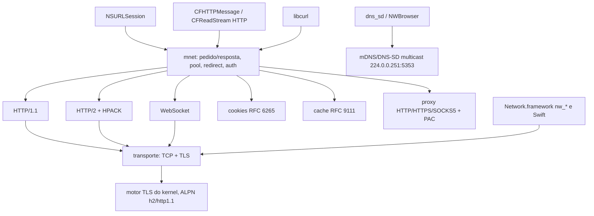

# Rede de alto nível para apps (frente da Patricia)

Dona: Patricia (`patricia/*`). Escopo: CFNetwork e NSURLSession completos (HTTP/1.1, HTTP/2, WebSocket,
cookies, cache, proxy, background), Network.framework (C `nw_*` e o módulo Swift `Network`), libcurl, TLS 1.3
completo, Bonjour/mDNS (`dns_sd.h`) e multicast UDP.

Fora do escopo (outros donos): drivers de placa (Felipe), `NSURL`/`NSURLComponents`/`NSData` (Eduardo),
runtime Swift (Fernanda), Keychain/SecTrust além do que o TLS precisa (Natalia).

## Levantamento (main `97c611b`, 15 nov. 2026)

| Peça | Onde estava | Estado encontrado |
|---|---|---|
| Motor TLS | `kernel/net/tls.c` + `crypto.c` + `x509.c`, syscalls `MOS_NET_TLS_*` | Cliente TLS 1.3/1.2, ALPN fixo `http/1.1`, sem servidor, sem retomada (ticket ignorado), sem certificado de cliente, sem ALPN negociável |
| SecureTransport | `userland/libsystem/securetransport.c` | Cliente sobre o motor do kernel; `SSLSetALPNProtocols` ignorado; lado servidor devolve NULL |
| NSURLSession | `userland/libsystem/foundation_more.c` (`http_do`) | Um pedido `Connection: close`, lê até o fim; **sem chunked**, sem redirect, sem keep-alive, sem cookies, sem cache, sem proxy, sem gzip, sem HTTP/2, sem WebSocket, configuração única compartilhada |
| libcurl | `userland/libsystem/libcurl_easy.c` | easy + URL parser, HTTP/1.1 com chunked e redirect; sem multi, sem share, sem cookies, sem HTTP/2, sem proxy |
| CFStream | `cfstream.c` | Só arquivo/memória sobre `NSInputStream`; par de socket em `wa_net.c` |
| CFHost / reachability | `cfhost.c`, `wa_net.c` | Resolução real; reachability com estado fixo |
| Network.framework C | `sys_zerados.c` | 25 `nw_*` vazios |
| Network Swift | `sys_zerados.c` | 154 símbolos vazios (`NWConnection`, `NWListener`, `NWBrowser`, `NWPathMonitor`...) |
| Bonjour | — | `DNSService*` inexistente |
| Multicast UDP | `kernel/net/userudp.c`, `sockets_udp.inc` | Saída passa; `IP_ADD_MEMBERSHIP` aceito e ignorado; entrada depende da placa; sem IGMP |
| Proxy | `sys_zerados.c` | `kCFNetworkProxies*` são ponteiros nulos; sem `CFNetworkCopySystemProxySettings` real, PAC devolve nulo |

## Arquitetura

Um núcleo C portátil, `mnet` (`userland/libsystem/mnet_*.c` + `mnet.h`), sem dependência de ObjC, compilado
igual no libSystem (freestanding) e no host (gcc) para os testes. Todas as APIs públicas (NSURLSession, CFNetwork,
libcurl, `nw_*`, `dns_sd`) são cascas finas sobre ele.

## Plano (ordem de entrega, um PR por etapa)

1. **Núcleo HTTP portátil** — parser incremental de resposta HTTP/1.1 (status, cabeçalhos dobrados, chunked com
   trailers, Content-Length, fim por fechamento, 1xx/100-continue), serialização de pedido, cookies RFC 6265
   (Set-Cookie, domínio/caminho, Expires/Max-Age, Secure, HttpOnly, SameSite, sufixo público básico, arquivo
   persistente), HPACK RFC 7541 (tabelas estática e dinâmica, Huffman). Testes de host.
2. **TLS 1.3 completo no motor** — ALPN configurável e lido de volta (`h2`, `http/1.1`), retomada por ticket
   (PSK, `psk_dhe_ke`), certificado de cliente, lado servidor (TLS 1.3, para `NWListener`/SecureTransport servidor),
   novas syscalls `MOS_NET_TLS_CONFIG`/`MOS_NET_TLS_INFO`; SecureTransport com ALPN real.
3. **HTTP/2** — quadros, fluxos, controle de fluxo, SETTINGS/PING/GOAWAY/RST, multiplexação no pool.
4. **NSURLSession novo** (sai de `foundation_more.c`, combinado com o Eduardo) — configurações reais
   (default/ephemeral/background), fila de delegate, data/upload/download/stream/WebSocket tasks, redirect com
   delegate, autenticação (Basic, Digest, servidor, cliente), cookies (`NSHTTPCookieStorage`/`NSHTTPCookie`),
   cache (`NSURLCache`), métricas, progresso, cancel/suspend/resume com resumeData, gzip/deflate/br, async Swift.
5. **WebSocket** — RFC 6455 (handshake, máscara, fragmentação, ping/pong, close), `permessage-deflate`,
   `NSURLSessionWebSocketTask`, `nw_ws_*`.
6. **Proxy** — `CFNetworkCopySystemProxySettings`, `kCFNetworkProxies*` reais, CONNECT, SOCKS5, PAC.
7. **Network.framework** — `nw_*` C completo (connection, listener, browser, path monitor, parameters,
   protocol options TCP/UDP/TLS/WS, framer) sobre o transporte; depois o módulo Swift (154) com a Fernanda.
8. **libcurl** — easy/multi/share sobre o núcleo (HTTP/2, cookies, proxy).
9. **CFNetwork restante** — `CFHTTPMessage`, `CFReadStreamCreateForHTTPRequest`, par de socket com TLS
   (`kCFStreamPropertySSLSettings`), `CFHost` assíncrono.
10. **Multicast e Bonjour** — `IP_ADD_MEMBERSHIP`/IGMPv2 no kernel (filtro da placa com o Felipe), mDNS
    (RFC 6762) e DNS-SD (RFC 6763): `DNSServiceRegister/Browse/Resolve/GetAddrInfo/QueryRecord`, `NSNetService`,
    `NWBrowser`.

## Estado

| Etapa | Estado | Teste |
|---|---|---|
| 1. Núcleo HTTP portátil | pronto (PR desta etapa): `mnet_util.c`, `mnet_h1.c`, `mnet_cookie.c`, `mnet_hpack.c` | `tools/mnet_host_test.c`: 638/638 no gcc com ASan/UBSan; os 12 blocos do Apêndice C da RFC 7541 decodificam e o codificador gera os mesmos bytes; `zig cc` freestanding x86_64 e arm64 compila sem aviso |
| 2. TLS (ALPN) | ALPN configurável e lido de volta; versão e cifra reais no SecureTransport. Falta: retomada por ticket, certificado de cliente, lado servidor | `tools/tls_local_test.c`: 14/14 contra `openssl s_server` (h2 em 1.3 e 1.2, queda para http/1.1, servidor sem ALPN) |
| 3. HTTP/2 | codec pronto (`mnet_h2.c`); ainda não ligado a API pública | `tools/mnet_host_test.c`: 9 MiB por janelas, 103 + 200 + trailers, CONTINUATION, PING, RST, GOAWAY, erros; servidor h2c do mnet contra o `curl --http2-prior-knowledge` do host (nghttp2): 201 e 64 KB de corpo |
| 4a. Motor do cliente | pronto (`mnet_client.c`, `mnet_decode.c`, `mnet_url.c`); ainda não ligado ao NSURLSession | `tools/mnet_client_test.c`: 22/22 contra `tools/mnet_http_servidor.py` (keep-alive, 5 redirects, laço, 303, 307 com corpo, delegate recusando redirect, gzip, chunked, cookies no redirect, tempo esgotado, erros); com `rede`: 35/35, HTTP/2 real por ALPN sobre o TLS do mOS em google, cloudflare, github e example.com, reuso de conexão, certificado vencido recusado |
| 4b. NSURLSession novo | escrito e compilado (`nsurlsession.c`, `urlsession_io.c`, `mnet_cache.c`); o antigo saiu de `foundation_more.c` (combinado com o Eduardo, que acrescentou a API de `NSURLRequest`/`NSHTTPURLResponse` no PR #316) | regras de cache: `mnet_host_test` 736/736; motor por baixo: `mnet_client_test` 35/35. As classes ObjC **não** rodaram: não há harness de host com o runtime ObjC; o primeiro teste delas é o build final |
| 5. WebSocket | núcleo (`mnet_ws.c`) e cliente sobre o transporte (`mnet_ws_open`) testados; `NSURLSessionWebSocketTask`/`NSURLSessionWebSocketMessage` escritos e compilados (não executados) | `mnet_host_test` 761/761: SHA-1, Sec-WebSocket-Accept e quadros da RFC 6455 §5.7, exemplos da RFC 7692 §7.2.3, erros 1002/1007, ida e volta com deflate e 3 × 1 MiB, close; servidor do mnet contra o cliente WebSocket do Node. `mnet_client_test rede` 38/38: `wss://echo.websocket.org` sobre o TLS do mOS |
| 6. Proxy | regras e constantes prontas (`mnet_proxy.c`, `cfproxy.c`); NSURLSession usa o proxy do sistema quando a configuração não tem um. **PAC não é avaliado**: falta o motor JavaScript no userland (combinando com o Fabio) | `mnet_host_test` 778/778: exceções (curinga, domínio, CIDR, prefixo, nomes simples, loopback), ordem PAC → HTTP/HTTPS → SOCKS → direto, leitura de resultado PAC |
| 6b. Interfaces, SystemConfiguration de rede, libresolv | syscall `MOS_NET_IFLIST` (placas reais do kernel), `netif.c` (`getifaddrs` com AF_INET/AF_INET6/AF_LINK e if_data, `if_nametoindex`/`if_indextoname`/`if_nameindex`), `scnetwork.c` (`SCNetworkInterface*`, `SCNetworkService*`, `SCPreferences*`, chaves kSC*), `res_9_nmkquery`/`nsend`/`setservers`/`getservers` | `tools/resolv_host.c`: consulta real montada por `res_9_nmkquery` e mandada por `res_9_nsend` (9.9.9.9). As partes que dependem da syscall nova só rodam no build final |
| 7. Network.framework C | `nwnet.c`: ~250 funções `nw_*`/`sec_protocol_*` (endpoints, parâmetros, pilha, opções TCP/UDP/TLS/WS/IP, conexão TCP/UDP/TLS/WS com send/receive/receive_message e metadados, listener TCP/UDP, monitor de caminho com interfaces reais, contextos, erros); saem os 26 stubs de `sys_zerados.c`, `vscode_network.c` e os de `chrome.c`/`security.c`. Falta `nw_browser` (Bonjour), `nw_framer` e TLS de servidor no listener | só compilado (x86_64/arm64): objetos ObjC com blocos, sem harness de host; o primeiro teste é o build final |
| 8–10 | não iniciado | — |

### Etapa 1 — o que está no código

- **HTTP/1.1** (`mnet_h1.c`): parser incremental em qualquer fatiamento (testado de 1 em 1 byte), 1xx descartado com
  evento, 101 marca upgrade, HEAD/204/304 sem corpo, chunked com extensões e trailers, Content-Length repetido igual
  aceito e diferente recusado, fim por fechamento, linha dobrada (obs-fold), CR solto e nome com espaço recusados,
  limite de 256 KiB na cabeça, keep-alive por versão e `Connection`, bytes da próxima resposta devolvidos (pipeline).
  O pedido corta CR/LF dentro de campos (sem injeção) e não manda `Content-Length: 0` em GET/HEAD.
- **Cookies** (`mnet_cookie.c`): RFC 6265 com as regras de 6265bis (SameSite, `__Secure-`/`__Host-`, Secure só de
  origem segura e não sobrescrito por origem insegura, CTL recusa o cookie, nome vazio). Public Suffix List inteira
  embutida (`mnet_psl.inc`, 10119 regras, MPL-2.0, IDN em punycode, curinga e exceção). Limites 3000 no total e 180
  por domínio, com despejo do menos usado. Arquivo Netscape do curl com `#HttpOnly_`.
- **Datas**: o algoritmo do RFC 6265 §5.1.1 (IMF-fixdate, RFC 850, asctime e variações) e a formatação IMF.
- **HPACK** (`mnet_hpack.c`): tabelas geradas do texto da RFC (`mnet_hpack_tab.inc`), Huffman canônico com checagem
  de EOS e de enchimento, tabela dinâmica em anel, atualização de tamanho (menor e final, §4.2), campos sensíveis como
  "nunca indexar".

Ainda não ligado a nenhuma API pública: isso entra nas etapas 2–4.

### Etapas 2 e 3 — o que está no código

- **ALPN** (`kernel/net/tls.c`): `tls_set_alpn` (lista no formato do fio, antes do handshake), `tls_get_alpn`,
  `tls_get_version`, `tls_get_suite`. A escolha do servidor é lida do EncryptedExtensions (1.3) ou do ServerHello (1.2)
  e recusada se não estiver na oferta ou se vier no ServerHello do 1.3. Syscalls novas `MOS_NET_TLS_ALPN` e
  `MOS_NET_TLS_INFO` (`mos_net_tls_info_t`). O SecureTransport passa a mandar a lista de `SSLSetALPNProtocols`,
  `SSLCopyALPNProtocols` devolve o escolhido e `SSLGetNegotiatedProtocolVersion`/`SSLGetNegotiatedCipher` dizem a
  verdade (antes: 1.2 e 0x1301 fixos).
- **HTTP/2** (`mnet_h2.c`): prefácio, SETTINGS (push desligado, 256 fluxos, janela 4 MiB por fluxo e 16 MiB na
  conexão), HEADERS/CONTINUATION com HPACK, DATA com enchimento, controle de fluxo nos dois sentidos com
  WINDOW_UPDATE, mudança de INITIAL_WINDOW_SIZE aplicada aos fluxos abertos, PING, RST_STREAM, GOAWAY (fluxos acima
  do último viram REFUSED_STREAM para serem refeitos), validação de campos (minúsculas, pseudo-cabeçalhos primeiro,
  campos de conexão proibidos), 1xx e trailers. Servidor também, para `NWListener` e testes.

### Etapa 4a — motor do cliente

- `mnet_fetch`: um pedido por chamada, bloqueante, transporte trocável (`mnet_io_t`: conectar, TLS com ALPN, ler e
  escrever com tempo, relógios, trava do pool). Pool por origem (até 32 ociosas, 90 s), segunda tentativa quando a
  conexão reaproveitada cai antes da resposta. HTTPS oferece `h2,http/1.1` e segue o que o servidor escolher.
- Redirect: 301/302 com POST e 303 viram GET sem corpo; 307/308 repetem método e corpo (corpo em fluxo só com
  `body_rewind`); limite de 16 (`NSURLErrorHTTPTooManyRedirects`); delegate pode trocar a URL ou receber o 3xx.
- Cookies do jar em todo salto (Set-Cookie de redirect vale no seguinte), `Accept-Encoding: gzip, deflate, br`
  com descompressão em fluxo, cabeçalhos de conexão do app descartados, `User-Agent`/`Accept`/`Accept-Language` padrão.
- Proxy HTTP (forma absoluta), túnel CONNECT para HTTPS (com `Proxy-Authorization`), SOCKS5 com usuário e senha e
  nome resolvido pelo proxy. Proxy HTTPS com destino HTTPS (TLS dentro de TLS) devolve `MNET_E_UNSUPPORTED`.
- Erros com os códigos de `NSURLErrorDomain` (-1001 tempo, -1003 nome, -1004 conexão, -1005 perdida, -1007, -1015,
  -1200 TLS...). Cancelamento por flag, conferida a cada 250 ms.
- Limite conhecido: pedidos simultâneos para a mesma origem em HTTP/2 usam conexões separadas (sem multiplexar).

### Etapa 4b — NSURLSession e companhia (`userland/libsystem/nsurlsession.c`)

- **Configuração**: default, ephemeral (jar e cache próprios, em memória), background (identificador guardado; roda em
  primeiro plano, não há daemon de transferência). Todos os campos públicos, cabeçalhos adicionais, proxy
  (`connectionProxyDictionary` HTTP/HTTPS/SOCKS), tempos de pedido e de recurso, política de cache e de cookies.
- **Tarefas**: dados, envio (dados, arquivo, fluxo com `needNewBodyStream:`), download (arquivo temporário entregue a
  `didFinishDownloadingToURL:` e apagado depois, progresso, `cancelByProducingResumeData:` e retomada por `Range` +
  `If-Range`). `resume`/`suspend` (suspender segura a entrega)/`cancel` (-999), estado, contadores, prioridade,
  `earliestBeginDate`, delegate por tarefa, métricas (`NSURLSessionTaskMetrics` com protocolo h2/http1.1 e reuso).
- **Delegate**: fila serial da sessão, ou a principal quando o app passou `mainQueue`; resposta (permitir, cancelar,
  virar download), dados, redirect (trocar ou recusar o pedido), desafios, envio, cache (`willCacheResponse:`),
  conclusão, `didBecomeInvalidWithError:` em `finishTasksAndInvalidate`/`invalidateAndCancel`, `getTasks`/`getAllTasks`,
  `reset`/`flush`.
- **Autenticação**: Basic e Digest (MD5, SHA-256, `-sess`, `qop=auth`), usuário da URL, `NSURLCredentialStorage`
  (sessão em memória, permanente no Keychain como senha de internet), desafio ao delegate com contagem de falhas,
  407 de proxy. Confiança do servidor: desafio `ServerTrust` com o `SecTrust` da cadeia em toda conexão TLS nova;
  como o kernel já recusa cadeia inválida, um app não consegue aceitar certificado autoassinado. NTLM/Negotiate: não
  há; o 401 é entregue.
- **Cookies**: `NSHTTPCookie` (propriedades, `cookiesWithResponseHeaderFields:forURL:` separando Set-Cookie juntados
  por vírgula, `requestHeaderFieldsWithCookies:`) e `NSHTTPCookieStorage` sobre o jar do mnet, persistido em
  `~/Library/Cookies/mos-cookies.txt` (formato Netscape), com as três políticas e as notificações de mudança.
- **Cache**: `NSURLCache` em memória e em disco (`~/Library/Caches/<bundle>/mos-urlcache`), chave URL + Vary, frescor e
  revalidação pelas regras de `mnet_cache.c`, 304 mesclado, políticas de pedido 0–5, `NSCachedURLResponse` completo.
- **NSURLProtocol**: classes registradas (globais e `protocolClasses`) interceptam pedidos; o cliente entrega resposta,
  dados, redirect, falha e resposta do cache para a tarefa. Propriedades por pedido (`setProperty:forKey:inRequest:`).
- **NSURLConnection**: síncrono, assíncrono com `NSOperationQueue`, e com delegate (resposta, dados, redirect, envio,
  cache, desafio com `sender`), em cima de uma sessão própria.
- **Fora (por enquanto)**: `NSURLSessionWebSocketTask` e `NSURLSessionStreamTask` (etapa 5), multiplexação HTTP/2 de
  vários pedidos numa conexão, APIs Swift `async` (`URLSession.data(for:)` etc.) que ficam na ponte Swift.

### Etapa 5 — WebSocket

- `mnet_ws.c`: handshake (chave, `Sec-WebSocket-Accept` com SHA-1 próprio, subprotocolo, validação do 101), quadros com
  máscara do cliente, fragmentação, ping/pong automático, close com eco e códigos válidos, UTF-8 do texto e do motivo,
  limite de mensagem (1009), permessage-deflate com janelas e `no_context_takeover` nos dois sentidos. Também o lado
  servidor (para `NWListener` e testes).
- `mnet_ws_open` (em `mnet_client.c`): `ws://`/`wss://` pelo mesmo transporte do HTTP (TLS com ALPN http/1.1, proxy
  CONNECT/SOCKS, cookies, Origin), quadros que chegam junto do 101.
- `NSURLSessionWebSocketTask`: `webSocketTaskWithURL:`/`:protocols:`/`WithRequest:` (http(s) vira ws(s)), `sendMessage`,
  `receiveMessage` (fila nos dois sentidos), `sendPing` com o pong, `cancelWithCloseCode:reason:` esperando o eco,
  `closeCode`/`closeReason`, `maximumMessageSize` (1 MiB), delegate `didOpenWithProtocol:` e `didCloseWithCode:reason:`,
  erro POSIX 57 para leituras pendentes depois do fechamento. WebSocket sobre HTTP/2 (RFC 8441) não é oferecido.
- Falta: os símbolos Swift de `URLSessionWebSocketTask.Message` (`sys_zerados.c`), com a ponte Swift.

### Etapa 6 — proxy

- `cfproxy.c`: todas as chaves `kCFProxy*`, `kCFNetworkProxies*` (antes ponteiros nulos em `sys_zerados.c`) e
  `kCFStreamNetworkServiceType*` como CFString; `CFNetworkCopyProxiesForURL` real; `cx_proxy_for` para NSURLSession e
  libcurl. As definições soltas em `cli.c` e `chrome.c` vieram para cá.
- Fonte do sistema: `CFNetworkCopySystemProxySettings` (`sysconfig.c`, `State:/Network/Global/Proxies` do configd).
- Falta: avaliar PAC (`CFNetworkCopyProxiesForAutoConfigurationScript`, `CFNetworkExecuteProxyAutoConfigurationURL`/
  `Script` e WPAD), que precisa de JavaScript no userland.
